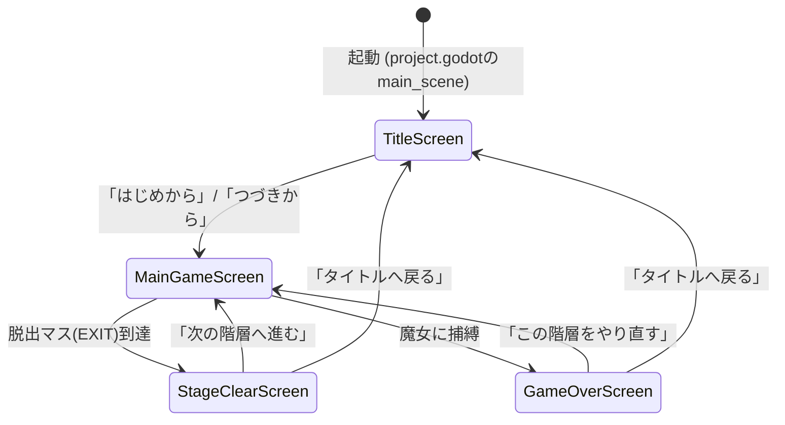
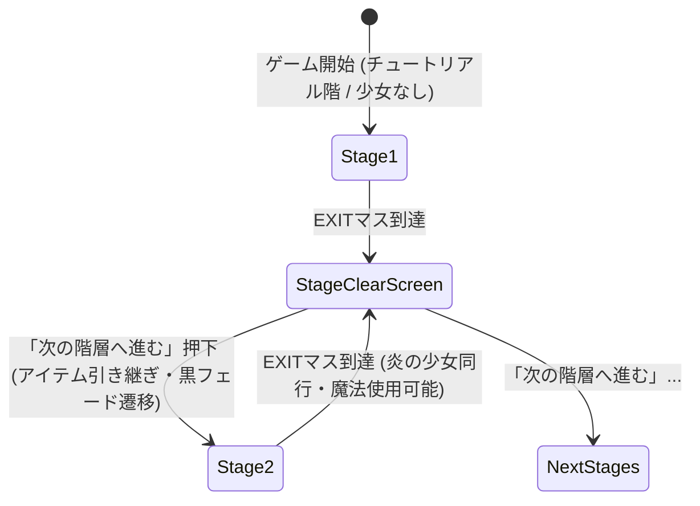

# PLAN & QA - プロジェクト・タスク推進の起点

## 1. 提案（User）
<!-- ここにやりたいこと、実装したい機能、思いついたアイデアなどを自由に書いてください。箇条書きでも口語でもOKです。 -->
凝ってない作品を一度完成させたい。
すごろく×魔女の館脱出ゲーム。
- 詳細な構想メモは [.spec/BEFORE.md](file:///c:/Users/mkf11/antigravity_base/sugoroku_dassyutu/.spec/BEFORE.md) に集約。
- ストーリーおよびアイテム周りの仕様を相談・決定してから実装へ進める方針。

## 過去フェーズのQA（アーカイブ）
完了したフェーズのQAは `.spec/plan/` に分割保存している。Q番号は通し番号のまま（次は最新Qの続き番号）。

| フェーズ | Q範囲 | ファイル | 主な内容 |
|---|---|---|---|
| 1. 要件定義 | Q1〜Q38 | [01_要件定義.md](plan/01_要件定義.md) | 世界観・ストーリー・エンド分岐・アイテム・魔女AI、暫定決定事項3〜7 |
| 2. 基本設計 | Q39〜Q53 | [02_基本設計.md](plan/02_基本設計.md) | 実装予定の機能、技術スタック、データモデル、ターン制御、画面設計、UXストレス軽減レビュー |
| 3. 詳細設計・PoC実装 | Q54〜Q71 | [03_詳細設計_PoC実装.md](plan/03_詳細設計_PoC実装.md) | PoC実装、Godot導入、バグ修正、ログ、コマンドメニューUI、_go_back、検証マップ |
| 4. CI・テスト基盤 | Q72〜Q80 | [04_CI_テスト基盤.md](plan/04_CI_テスト基盤.md) | GitHub Actions、ブランチ運用、結合テスト方針、UT仕様書マトリクス化 |
| 5. 機能実装（現行） | Q81〜 | このファイル | 画面遷移、フロア遷移、魔女AI改修、セーブ・中断セーブ、水罠バグ |

## 2. 深堀り・QA（Agent & User）
<!-- Agentは提案内容に対して、要件定義や設計に必要な深堀り質問をここに追記してください。
Userはそれに回答し、仕様が明確になるまでここでQ&Aのサイクルを回して詳細を詰めます。 -->

## 現行フェーズ：5. 機能実装（Q81〜）

### Q81. [Agent] 全体的な画面遷移（Scene Transition）の設計・実装方針について
ユーザー様より「フロア遷移ではなく、全体的な画面遷移をとりあえず作りましょう」とのご指示をいただきました。
基本設計書（[画面設計書_および_画面遷移図.md](file:///c:/Users/mkf11/antigravity_base/sugoroku_dassyutu/基本設計/画面設計書_および_画面遷移図.md)）に基づき、全体的な画面遷移システムの構築方針について確認・ご提案いたします。

#### 1. 遷移フローと対象画面
現在、個別シーンとして `main_game.tscn`, `game_over_screen.tscn`, `stage_clear_screen.tscn` が存在しています。
これらを束ねる全体遷移として以下を構築します：



#### 2. 遷移マネージャー（SceneManager）の構成案
- **Autoload（シングルトン）`SceneManager` の導入：**
  - シーン切替（`change_scene_to_file`）を一元管理し、画面間のパラメータ（選択ステージ、引き継ぎデータ等）を安全に保持・受け渡し。
  - **トランジション演出（暗転フェード）：**
    - ホラーゲームの質感に合わせ、画面遷移時にシンプルな黒フェードアウト＆フェードイン（0.3秒〜0.5秒程度）を挟むことで、不自然な画面のチラつきやカクつきを防止。
- **タイトル画面（`title_screen.tscn` / `title_screen.gd`）の新設：**
  - タイトルロゴ、霧・不穏な雰囲気の背景レイアウト。
  - 「はじめから」「つづきから（セーブデータ存在時のみ活性）」「設定（ConfigModal）」「ゲーム終了」ボタン。
  - `project.godot` の `run/main_scene` を `title_screen.tscn` に変更。

**A81. [User]** 
「作ってください．足りなければ言います」

---

### Q82. [Agent] ユーザー様からの不具合・仕様改善4項目の分析と改修計画
ユーザー様より以下の4点の不具合報告および改善要望をいただきました。原因の調査結果と改修方針を整理・記録いたします。

1. **タイトルからヘルプへいけない**
   - **原因：** `title_screen.gd` で `help_modal.show_modal()` を呼び出していたが、`HelpModal` クラスで定義されているメソッド名が `open()` であったため未定義エラーが発生。
   - **改修方針：** `HelpModal` に `show_modal()` エイリアスを追加し、`title_screen.gd` からも安全に呼び出せるよう修正。
2. **クリア後にもう一回を選択したときに次のゲームでアイテムが引き継がれない**
   - **原因：** `MainGame._init_poc_stage()` 内で毎回 `inventory.clear()` され、初期ダイス（1の賽）のみにリセットされていた。
   - **改修方針：** `_init_poc_stage(preserve_inventory: bool = false)` 引数を新設し、ステージクリア後の「もう一回（再挑戦・次階層）」時は所持インベントリを維持・引き継ぐ。
3. **戻る（振り出しマス）に止まったとき、主人公のグラフィックがスタートへ戻らない（内部的な位置は戻っている）**
   - **原因：** `TurnManager.resolve_stop_cell` の `returned_to_start_applied` 発火時に `position` を更新しても、直後に `UnitPiece` の Tween が終了マス（振り出しマス）へ移動プロパティを上書き実行していた。
   - **改修方針：** `returned_to_start_applied` 受信時にピースの実行中 Tween を即座に `kill()` し、初期座標へ瞬時に同期。Tween 完了時にも論理座標との一致を保証。
4. **ぴったり止まれなくても、EXITマスは移動可能距離が足りていれば必ず選択肢に入ってほしい**
   - **原因：** `GridBoard.get_reachable_cells_with_steps` が「正確に指定歩数（steps）進んだマス」のみを抽出していたため、出目が余っている場合にEXITが候補から除外されていた。
   - **改修方針：**
     - `get_reachable_cells_with_steps` において、1歩〜steps歩の到達範囲内に `CellType.EXIT` が含まれる場合、自動的に到達可能マス（ハイライト対象）に追加する。
     - `find_path_with_steps` においても、目標マスが `EXIT` かつ最短経路の長さが出目以下の場合は、最短経路でゴールへ停止できるように拡張する。
     - 単体テスト `UT-BOARD` に「出目が余っていてもEXITマスへ到達可能であること」を検証するテストケースを追加。

**A82. [User]** 
ユーザー様からご報告いただいた4点の不具合および改善要望に対応し、単体テスト（UT-BOARD-N05）の拡充およびCI自動テスト（149テスト 100% Pass）にて検証を完了いたしました。
- ① `HelpModal.show_modal()` 実装により、タイトル画面からヘルプモーダルが正常に展開されることを確認。
- ② ステージクリア後の「もう一回」選択時に、所持インベントリ（賽アイテム等）を引き継いで再開するよう `_on_stage_clear_retry` を実装。
- ③ 振り出しマス（`RETURN_TO_START`）停止時に、実行中Tweenを即時破棄し、スタートマス座標へのグラフィック強制同期を実装。
- ④ 出目が余っている場合でも、移動可能距離内であれば `EXIT` マスが必ず到達可能マスとして選択肢に含まれ、最短歩数でゴールへ停止できるようアルゴリズムを拡張。

---

### Q83. [Agent] マップ移動・フロア遷移システム（StageData & Floor Transition）の設計・実装方針について
次の主要タスクである **「マップ移動・フロア遷移の実装（EXIT到達時の次階層ロード）」** に着手いたします。
企画Q&A（Q21, Q25）および基本設計に基づき、フロア遷移フレームワークの設計方針についてご提案・確認いたします。

#### 1. ステージデータ構造（`StageData` / `StageRepository`）
現在 `main_game.gd` に直接ハードコードされている盤面生成処理を分離し、データドリブンに各階層のマップ・配置・同行者を読み込める構成にします。

- **ステージ情報モデル：**
  - `stage_id`: `"STAGE_1"`, `"STAGE_2"`, ...
  - `stage_name`: `"Stage 1: 2F 廊下・客室"`, `"Stage 2: 1F キッチン・食堂"`, ...
  - `board_data`: グリッドサイズ、マス種別辞書、接続関係
  - `hero_start_coord`: 主人公の初期座標
  - `witch_configs`: 各魔女の初期座標・追跡タイプ（配列）
  - `companion_config`: その階層にいる少女の設定（ID, 名前, 属性, 初期座標）。Stage 1 は `null`、Stage 2 は炎の少女など。
  - `next_stage_id`: 次階層のID（最終ステージの場合は `""` またはエンディング指定）

#### 2. フロア遷移のゲーム進行フロー


- **クリア画面のUI表示：**
  - ボタン1：`「次の階層へ進む」`（初期フォーカス。次のステージへアイテムを引き継いでフェード遷移）
  - ボタン2：`「タイトルへ戻る」`（現在のクリア状態をセーブしてタイトルへ戻る）
  - ※ 最終階層クリア時は「エンディングへ進む」に切り替え。

#### 3. 今回の実装スコープの確認
- (A) **フレームワーク＋先行2ステージ（推奨）：**
  - ステージデータ管理クラス（`StageRepository`）とフロア遷移機構を構築。
  - まず **Stage 1（チュートリアル：少女なし）** と **Stage 2（1Fキッチン：炎の少女同行、魔法使用可能）** を作成し、EXIT到達 → 次階層ロード → 炎の魔法が使えるステージへ進む一連のゲーム体験を確実に成立させる。
- (B) **全6ステージの一括定義：**
  - Stage 1〜Stage 6（水・風・土の全階層）の盤面データまで一気に定義して結合する。

**A83. [User]** 
「1をマップデータ自体は仮置きして作ります．中身のマップの構造とかイベントとかは後回しにして，先にシステム部分を完成させる方針．
その後，すべての遷移をやりましょう」

---

### Q84. [Agent] 1面（魔法使い不在時）のクラッシュエラー詳細・発生操作の確認
ユーザー様より「1面で魔法使いが居ないため落ちている。いないパターンも存在するのでそのように修正してほしい」とのご報告をいただきました。
確実に原因を解消するため、以下の点について確認させてください。

1. **エラーが発生したタイミング・操作：**
   - (A) ゲーム開始（「初めから」押下直後、ステージロード時）
   - (B) ダイスを振って移動完了後（魔女の思考・行動へ移行する瞬間）
   - (C) コマンドメニューの「魔法」ボタン等を押した時
   - (D) その他（どの操作の瞬間に落ちたか）
2. **Godotデバッガ（OutputまたはDebuggerタブ）に表示されたエラーメッセージ：**
   - 例: `Invalid get index ... (on base: 'Dictionary')`、`Nonexistent function ...`、または発生箇所のスクリプト名と行番号（`main_game.gd:509` など）

**A84. [User]**
```gdscript
hud.set_action_buttons_enabled(false)
hud.update_turn_info(tm.current_turn, "魔女の行動中...")
hud.log_message("[Enemy] 魔女のターン開始。思考中...")

var witch = tm.enemies["WITCH"]
var target = tm.select_witch_target(witch)
var witch_piece = board_view.get_piece("WITCH")
```
「これの宣言のところで落ちってるっぽい？よく見ると魔女ですね...」
→ 原因特定：旧PoCの固定ID `"WITCH"` がハードコードされており、Stage 1 の定義 ID `"WITCH_1"` と不一致を起こしていたこと、および複数魔女・魔女0体に対応していないことが原因。

---

### Q85. [Agent] 魔女ターゲット優先順位および潜行解除・ターゲット消失バグの調査と改修方針
ユーザー様より以下のご指摘をいただきました：
- ターゲットの優先順位が常に魔法使い優先になっている
- ターゲットされたキャラが居なくなった後、魔女のターゲットが居なくなり、行動しなくなる
- 潜行魔法の効果が解けないせいの可能性もあり

**【調査・分析結果】**
ユーザー様の推察が完全に的中しておりました！
1. **潜行解除漏れ：**
   - 「ダイス移動」および「他属性魔法詠唱」時に `is_burrowed = false` （地上出現）に戻す処理が未実装だったため、一度潜行すると永久に潜行フラグが残っていました。
   - 主人公で「魔法」コマンドを押すと土魔術（潜行）が発動し、そのままダイスを振っても潜行が解けないため、魔女の索敵候補（`not is_burrowed`）から除外され、結果として「常に魔法使い（少女）が優先」となっていました。
2. **主人公の魔法コマンドの誤発動：**
   - Stage 1〜5 では主人公自身は固有魔法を持たない（少女のみが魔法を行使する）仕様ですが、主人公選択時にも「土魔術」が強制発動するコードになっていたため、誤って潜行状態に突入していました。
3. **全員潜行時（ターゲット消失時）の魔女AI停止：**
   - 少女が倒される・または味方が全員潜行状態になると `target == null` となりますが、設計仕様（`UT-ENEMY-N03` / `IT-TRN-011`）では「初期配置位置（`witch.initial_coord`）へ帰還移動」するべきところ、`main_game.gd` では `target == null` の際に移動を行わずスキップしていたため、魔女が一切行動しなくなっていました。

**【改修方針】**
1. ダイス移動開始時、および魔法詠唱時に `unit.is_burrowed = false` かつ `unit_piece.set_burrowed(false)` を確実に実行（地上出現）。「祈る/待機」時のみ潜行を維持。
2. 主人公選択時の「魔法」コマンドは、固有魔法（`available_magics`）を持たない通常ステージでは非活性化（無条件に土魔術で潜行しないように修正）。
3. `main_game.gd` の魔女行動処理にて、`target == null`（全員潜行または索敵不能時）は初期位置（`witch.initial_coord`）へ向かって最短経路で移動するよう修正。

---

### Q86. [Agent] 次回着手する「セーブ機能」の目的と位置付けの明確化
ユーザー様より「ミスリードチックになっているので修正します。デバッグをしやすくするためにこのタイミングで着手します。デバッグのための機能ではありません」との極めて重要なご指摘・補足をいただきました。

**【意図の整合と認識共有】**
- **誤った認識：** デバッグ専用・テスト専用の簡易的なジャンプ機能やチートコマンドを作る。
- **正しい認識（ユーザー様の真意）：**
  - 作るのは**ゲーム本編に必要な「正式なセーブ・ロードシステム（セーブデータ型 `SaveData`、保存・読込処理、ファイルI/O）」**である。
  - 本編を進めるにつれて後半ステージや特定シチュエーションの検証コストが増大するため、**デバッグ・動作確認をしやすくする目的で、正式なセーブ・ロード機能をこのタイミングで前倒しして実装する**。
  - 正式なセーブ・ロード機能が完成すれば、自然と特定フロア到達時のセーブデータから再開・確認できるようになり、以後の開発と本番クオリティの両方に直結する。


---

### Q87. [Agent] セーブデータの保存内容の精査（ステージクリア時のみ自動セーブ／3スロット）
**A86補足. [User]** セーブスロットは3つ。自動セーブはステージクリア時のみ。保存内容はこのタイミングだと不要なものが多いので、精査してから確認する。

**【精査結果】** 現行コード（`main_game.gd` の `load_stage(stage_id, preserve_inventory)`）では、ステージ間で引き継がれているのは**所持アイテム（`inventory`）のみ**。他の状態は `load_stage` で毎回初期化されます。

| 項目                                                                            | 保存要否 | 理由                                                           |
| ------------------------------------------------------------------------------- | -------- | -------------------------------------------------------------- |
| 次のステージID（`next_stage_id`）                                               | **必須** | 再開地点                                                       |
| 所持アイテム（賽の種類・目）                                                    | **必須** | 唯一のステージ間引き継ぎ状態                                   |
| セーブ日時・クリア済みステージ名（表示用）                                      | 推奨     | スロット選択画面の表示用                                       |
| セーブデータのバージョン番号                                                    | 推奨     | 将来の仕様変更時の互換判定                                     |
| 将来用：ストーリーフラグ（石碑既読、介錯済み、Bエンド用アイテム、術者の証など） | 要検討   | エンド分岐に必要。現状は未実装なので空の辞書で枠だけ確保する案 |
| 将来用：ルート状態（行き／逆走）                                                | 要検討   | True Endの逆走用。現状は未実装                                 |
| 味方・魔女の座標・生死・復活カウンタ                                            | **不要** | 次ステージ開始時に初期配置へリセットされる                     |
| ターン数、現在のダイス出目、行動済みフラグ                                      | **不要** | 同上                                                           |
| 潜行状態、水トラップ、消費済み宝箱マス                                          | **不要** | 同上（ステージ内状態）                                         |
| 通過したステージの宝箱取得状況                                                  | 要検討   | 逆走時に再取得可能にするか                                     |

**確認事項**
1. 上記の「必須＋推奨」のみで進めてよいか（所持アイテム・次ステージID・セーブ日時・バージョン）。
2. 将来用のストーリーフラグとルート状態は、今は空の枠（`flags: {}`、`route: "forward"`）だけ用意し、必要になった時点で拡張する方針でよいか。
3. 逆走時に宝箱を再取得できるようにするか（現状は「取得状況を保存しない」想定）。

**A87. [User]** 
宝箱からは複数回取得可能な予定なので，そもそもフラグを保持する必要はない
語弊がありそうなので，一回取ったら，クリアをせずにそのマスを踏んでも取得できないが，エンディング後に，フロア再挑戦ができるようにするので，そのタイミングで再度宝箱は取得可能(以前にも書きましたが...)
以前にも言いましたが，逆走はシナリオ上の話であって，実装上は一切関係ないので，そのフラグはいらない．ストーリーフラグを仮置きでいい(現時点では踏んだイベントマスと，ストーリー進行フラグ，クリアフラグかな)
必須+推奨でいいです
実績機能を追加する可能性があるので，そのためのカウンタも必要かも
一旦実績用の枠だけ確保しておいて

**[Agent] A87の反映（確定事項）**
- 保存内容：バージョン、セーブ日時、次ステージID、クリア済みステージ名、所持アイテム、ストーリー仮置き枠（踏んだイベントマスID・進行フラグ・クリアフラグ）、実績カウンタ枠（空）。
- 不採用：ルート状態（逆走は実装上無関係）、宝箱取得フラグ（エンディング後の再挑戦で再取得可能な想定のため、ステージ内状態として保存しない）。
- スロットは3つ。オートセーブはステージクリア時のみ（次ステージがある場合）。保存先は「はじめから」時に空きスロット優先で決定（全使用ならスロット1）、「つづきから」で選んだスロットが保存先になる。


---

### Q88. [Agent] リトライ時の所持品の扱いと手動セーブの仕様
**A87補足. [User]** 所持品を捨てないでほしい。ゲームオーバー時はタイトルへ戻るかリトライなので、アイテムをロストさせる仕様をどのタイミングで入れられるのか。手動セーブは必要な気がする。1つだけスナップショット的に保存し、ロードしたら消える形はどうか。

**【回答・対応】**
1. **所持品の扱い（実装済み）：** リトライ時は「そのステージ開始時点の所持品」へ戻して再開する（初期化しない）。失敗した挑戦中に使った賽は戻り、宝箱で拾った賽は取り直しになる。
2. **ロスト仕様を入れるタイミング：** 現状の導線（ゲームオーバー→リトライ／タイトル）では、アイテムが失われる契機は存在しない。入れるなら「リトライ時に、ステージ開始時所持品から一定数を減らす」くらいしか挿入点がなく、プレイヤーの不利益のみになるため、**ロスト仕様は設けない方針**を提案する。
3. **手動セーブ案（スナップショット方式）：** 中断セーブを1枠だけ用意し、ロードすると消える（一時退避用）。

**確認事項**
- (a) 中断セーブはステージ途中の盤面状態（全ユニット座標・生死・復活カウンタ・ターン数・潜行・水トラップ・消費済みマス・手番状況）まで保存する必要があり、ステージクリア時セーブと異なり保存項目が大幅に増える。この方針でよいか。
- (b) 保存できるタイミングは「プレイヤーターンの行動選択待ち中のみ」に限定してよいか（移動中・演出中は不可）。
- (c) 中断セーブは、ロード後に消えるだけでなく、タイトルの「つづきから」のスロット選択に「中断データ」として並べてよいか。ロードせずに新たに中断セーブした場合は上書きでよいか。

**A88. [User]** 
まずは，そもそもゲームオーバー時はどの選択肢を選んでもセーブロードから始める想定だったので，その議論自体がおかしいと思っています．これを書いた時点では実績機能も存在していないので，ゲームオーバー時にセーブを入れる意味が皆無です．このやり方でよくない点があるなら教えてほしいです．というか，タイトルまたは，やり直ししか選択肢がない時点で当然そういう風に実装するものと考えていました．ここを分岐させようとする理由が分かりません．

確認事項の方はa,bはそのままでいいです．cに関しては，どのデータをロードしても中断データは消えます．本当に一時離席用の機能でしかないつもりです

**[Agent] A88の反映（確定事項・実装済み）**
- ご指摘のとおり、ゲームオーバー後の選択肢（リトライ／タイトル）はどちらも「セーブから始める」で統一する。先の「ステージ開始時所持品へ戻す」実装は取り下げ、リトライ＝セーブ（ステージ開始時の状態）のロードに変更した。ロスト仕様の議論も不要。
  - 補足：新規ゲーム中でまだ一度もクリア保存していない場合（ステージ1）は、スロットに他の周回の古いデータが残っていても読み込まないよう、「今回の周回でセーブ済み／ロード済みか」を判定し、未保存なら最初から始める。
- 中断セーブ（確認事項a・b・cの回答どおり）：ステージ途中の全盤面状態を保存。保存できるのは行動選択待ち中のみ。1枠のみで、どのデータ（通常スロット・中断データ）をロードしても中断データは消える。タイトルの「つづきから」一覧に「中断データ」として表示。
- 中断セーブ実行後はタイトルへ戻る（一時離席用のため）。


---

### Q89. [Agent] 「はじめから」でセーブ先スロットを選び、開始時に初期セーブを作る方式
**A88補足. [User]** ゲーム開始時のタイトル画面でセーブする場所を決める方式にすれば、セーブデータがない時の処理も必要なくなりそう。

**【検討結果】** 有効な案です。次のとおり整理します。

| 項目                            | 現状                                                         | 提案方式                                                                        |
| ------------------------------- | ------------------------------------------------------------ | ------------------------------------------------------------------------------- |
| 「はじめから」                  | 空きスロットを自動選択（全使用ならスロット1）                | スロット選択画面で保存先を選ぶ                                                  |
| 開始時のセーブ                  | なし（最初のクリアまで存在しない）                           | 選んだスロットへ**ステージ1開始状態の初期セーブを即作成**                       |
| リトライ                        | 保存済みかを `checkpoint_valid` で判定し、未保存なら最初から | 常にスロットからロード（`checkpoint_valid` と「セーブが無い場合」の分岐を廃止） |
| 中断データの `checkpoint_valid` | 保存する                                                     | 不要（廃止）                                                                    |

**メリット：** 周回ごとに必ず自分のスロットが存在し、「古い周回のデータを誤って読む」「未保存周回」の特殊処理が消える。リトライとつづきからの挙動が完全に同じになる。

**注意点（確認事項）**
- (a) 使用済みスロットを選んだ場合は上書きになる。上書き確認ダイアログ（「スロットNのデータは消えます。よろしいですか？」）を出してよいか。
- (b) 初期セーブの `cleared_stage_name` は空でよいか（スロット一覧では「開始前」と表示する想定）。
- (c) 実装は上記の変更を先にテスト（`UT-SAVE`）へ追加し、`main_game.gd` の `checkpoint_valid` と `_reset_progress` 周りを整理する方針でよいか。

**A89. [User]** 
a. 出しましょう
b. いいですよ
c. いいですよ．スキル通り，テストの修正時はこちらに提案していただき，ありがとうございます


**[Agent] A89の反映（確定事項・実装完了）**
- タイトル画面の「はじめから」でセーブ先スロット（1〜3）を選択するUIを実装。使用済みスロット選択時は上書き確認ダイアログを表示。
- スロット確定時に `SaveData.new_game("STAGE_1")` でステージ1開始状態の初期セーブを即作成し、スロット一覧では `is_initial()` の場合に「開始前」と表示。
- これにより周回開始時から必ず対象スロットにセーブが存在するため、`checkpoint_valid` や未保存時の分岐（`_reset_progress` / `_restore_checkpoint_or_restart`）を廃止し、リトライ時は常に `_restore_checkpoint()` で現在スロットからロードする単一フローに整理完了。
- 単体テスト `UT-SAVE-N08`（初期セーブデータ生成・判定）および `UT-SAVE-D01`（新規ゲームによるスロット上書き・作成）を追加・更新し、全10スイート348項目合格を確認。


---

### Q90. [Agent] 実機動作確認の完了と次回最優先課題（設置した水罠関連のバグ）
**A89補足. [User]** 動作確認はできた。設置した水罠関連でバグっているが、これは次回へのTODOにして本日は終了する。

**[Agent] 次回に向けた記録**
- セーブ・ロードシステム（3スロット、開始時スロット選択＆初期セーブ作成、クリア時オートセーブ、中断セーブ、リトライ時のセーブ復帰統一）の実機動作確認が完了。
- 次回セッションの最優先事項として、**「設置した水罠（水魔術トラップ）関連のバグ調査・修正」**を `TODO.md` および `HANDOFF.md` に記載済み。次回開始時に具体的な事象（発生状況や挙動）をヒアリング・調査して改修を行う。

### Q91. [Agent] `.claude/settings.json` 未作成の件
**[Agent]** CLAUDE.md には権限設定（`Edit(/**)`・`git`・`run_tests.ps1` の事前許可、`git push --force/-f` の deny、`autoMemoryEnabled: false`）が「設定済み」と書かれているが、実際には `.claude/settings.json` が存在せず、どれも効いていない。CLAUDE.md の記載どおり作成してよいか？

**A91. [User]** 記載どおり作成する。

**[Agent] 対応**
- `.claude/settings.json` を CLAUDE.md の記載どおりの内容で作成（`feature/claude-settings` ブランチ）。

### Q92. [Agent] `/newplan` で `.spec/plan/` も一緒に退避するか
**[Agent]** `/newplan`（新しい開発サイクルの開始）は PLAN.md だけを `PLAN-YYYY-MM-DD.md` にリネームする手順になっている。フェーズ分割で作った `.spec/plan/` も一緒に退避する手順を加えるか？

**A92. [User]** 終わったフェーズの別バージョンを取る意味が薄いので、一緒に退避しなくてよい。

**[Agent] 対応**
- `/newplan` の手順は変更しない。`.spec/plan/` は新しいサイクルでもそのまま残し、フェーズ番号を続けて使う。

### Q93. [User] 水魔術の設置位置指定・特殊マスへの設置禁止、および復活魔女による捕縛
**[User]**
- 水魔術の設置位置を自分で決められるようにしたい。他の特殊マスの上には置けないようにしたい。
- 射程は全範囲でよいが、変える可能性があるので、いったん適当な定数で置いておく。
- 炎魔術で倒した魔女が復活するターンに、復活位置（魔女の初期位置）にキャラが止まっていたら、復活したタイミングでそのキャラは捕まった判定にする。

**[Agent] 仕様の整理（指示のない細部はエージェント判断。変更があれば指示してください）**

| 項目 | 内容 |
| --- | --- |
| 設置先の決め方 | 水魔術を選ぶと設置可能マスがハイライトされ、クリックしたマスに設置する |
| 設置できるマス | `NORMAL` マスのみ。EXIT・イベント・+2・戻る・休み・もう1回・設置済みの水罠には置けない |
| ユニットのいるマス | 置ける（自分の足元も可）。罠は「進入したとき」に発動するので、その場にいるユニットには効かない |
| 射程 | 定数 `TurnManager.WATER_TRAP_RANGE`（通路をたどった距離）。`-1` は全範囲で、現在値は `-1` |
| 設置先の選択中 | 右クリック／Esc でコマンドメニューに戻れる（まだ行動は確定していないため） |
| 置ける場所がない場合 | コマンドメニューの魔法を使用不可にする |
| 復活時の捕縛 | 魔女が復活した瞬間、復活位置にいる地上のキャラを捕縛する。主人公はゲームオーバー、少女は殺害（3ターン後に復活）、潜行中のキャラはやり過ごし |
| 判定のタイミング | ターン終了処理（`end_turn_and_advance`）の魔女の復活直後。主人公が捕まった場合は次のプレイヤーターンを始めない |

**[Agent] 対応**
- 単体テストを追加（UT-MAGIC-N06/E05/E06/B02、UT-TURN-N06/N07/D01）。既存テストの修正はなし。
- `TurnManager` に設置可否判定・設置可能マス一覧・復活時の捕縛判定を追加し、`main_game.gd` に設置先の選択モードを追加。

**A93. [User]** 水魔術の設置先選択・特殊マスへの設置禁止・復活時の捕縛は実機で確認できた。

### Q94. [User] 風魔術の実装
**[User]** 風魔術はそもそも実装されていない。主人公・魔法使い・魔女の誰か一人を選び、方向を選んで、その方向の最も遠いマスまで吹き飛ばす。主人公や魔法使いを吹き飛ばしたときに魔女にぶつかったら倒される。射程をつける予定はないが、一応定数で入れておく。

**[Agent] 確認事項（AskUserQuestion）**
- (a) 吹き飛ぶ進路上にほかのユニットがいた場合（キャラが魔女にぶつかる場合以外）は？
- (b) 着地マスの効果（出口・宝箱・+2・戻る・休み・もう1回）は発動させるか？
- (c) 進路の途中に水罠があった場合は？
- (d) 潜行中のユニットは対象にできるか？

**A94. [User]**
- (a) すり抜ける（キャラが魔女にぶつかる場合を除き、ユニットは互いにすり抜ける。着地マスに誰かいる場合だけ、その手前で止まる）
- (b) 発動しない
- (c) 素通りする
- (d) 対象にできない

**[Agent] 仕様の整理（指示のない細部はエージェント判断）**

| 項目 | 内容 |
| --- | --- |
| 対象 | 生存中で潜行していない主人公・少女・魔女（詠唱者自身も可）。射程は定数 `TurnManager.WIND_RANGE`（詠唱者から通路をたどった距離。`-1` は全範囲で現在値 `-1`） |
| 方向 | 上下左右。通路がつながっている限りまっすぐ進んだ最も遠いマスへ飛ぶ。1マスも動けない方向は選べない。動ける方向がない相手は対象にできない |
| 魔女との衝突 | 主人公・少女が進路上の魔女のマスに入った時点で止まり、捕縛される（主人公はゲームオーバー、少女は殺害）。魔女を飛ばしたときに進路上のキャラは捕まらない（すり抜け） |
| 着地マスが埋まっている | 空いているマスまで1マスずつ手前に戻る |
| 操作 | 魔法を選ぶ→対象ユニットのマスをクリック→着地マス（方向ごとにハイライト）をクリック。右クリック／Escで1つ前に戻る |

**[Agent] 対応**
- 単体テストを追加（UT-MAGIC-N07/N08/N09/E07/B03/D02）。既存テストの修正はなし。
- `TurnManager` に `execute_wind` ほか風魔術の判定関数を追加（`execute_magic` の WIND は受け付けないよう変更）。`main_game.gd` に対象選択→着地マス選択の操作を追加。
- 要件定義（システム設定.md）・基本設計・詳細設計の風魔術の記述を本仕様に更新。

**A94補足. [User]** 風魔術の動作確認はOK。

### Q95. [User] 操作が毎回ダブルクリックのようになる
**[User]** そもそもの操作がなんかへん。毎回ダブルクリックになっていますか？

**[Agent] 調査結果と対応**
- 盤面のコマ（`unit_piece.tscn` の `Sprite`／ColorRect）のマウス設定が既定の STOP のままで、コマの上をクリックするとクリックがそこで止まり、下のマスに届いていなかった。ユニットをクリックする操作（風魔術の対象選択、盤面確認中のキャラ切り替え、ユニットのいるマスへの水罠設置）で1回目が無反応になり、2回クリックが必要に見えていた。
- `Sprite` を `mouse_filter = IGNORE` に変更。単体テスト UT-SCENE-N04 を追加（修正前は失敗、修正後は合格を確認）。
- これで直らない操作が残っていれば、どの操作か教えてもらって追加調査する。

**A95. [User]** クリックの件はOK。

### Q96. [User] 土魔術の実装（射程6）
**[User]** 魔法関連を終わらせたい。土の実装もお願いします。射程は6。

**[Agent] 確認事項（AskUserQuestion）**
- (a) 【既存テスト修正の事前報告】土魔術を「ユニットを選んで実行」する `execute_earth` にし、既存テスト UT-MAGIC-D01 の「誰もいないマスを指定すると詠唱者自身が潜る」ケースを「自分を選ぶ→潜る／味方を選ぶ→味方が潜る／魔女を選ぶ→スタン」の3ケースに書き換えてよいか？
- (b) スタンした魔女のマスに地上のキャラが入った場合は捕まるか？

**A96. [User]**
- (a) 書き換えてよい
- (b) 捕まらない

**[Agent] 仕様の整理（指示のない細部はエージェント判断）**

| 項目 | 内容 |
| --- | --- |
| 対象 | 射程内（定数 `TurnManager.EARTH_RANGE = 6`、詠唱者から通路をたどった距離）の、生存中で潜行していない主人公・少女（自分自身も可）、またはスタンしていない生存中の魔女 |
| 効果 | 味方：潜行状態にする。魔女：1ターン行動不能（スタン） |
| 詠唱者の潜行 | 自分以外を対象にしたときは、詠唱で地上に出る（潜行解除） |
| スタン中の魔女 | 無害。踏んでも捕まらず、到達可能マスからも除外しない。風魔術で飛ばしたキャラもぶつからない。着地もできる |
| スタンの解除 | ターン終了時に1減る（これまでどこでも減らしておらず、スタンが永久に続くバグがあったので修正）。解けた瞬間に同じマスにいる地上のキャラは捕まる（復活時の捕縛と同じ扱い） |
| 操作 | 魔法を選ぶ→対象ユニットのマスをクリック。右クリック／Escでコマンドメニューに戻る |

**[Agent] 対応**
- 既存テスト UT-MAGIC-D01 を A96(a) のとおり書き換え。単体テストを追加（UT-MAGIC-E08/B04/N10、UT-TURN-N08/N09）。
- `TurnManager` に `get_earth_targets` / `execute_earth` を追加し、`execute_magic` の EARTH は受け付けないよう変更。ターン終了時のスタン減算と、解除時の捕縛判定を追加。`EnemyData.is_dangerous()` を追加し、捕縛判定・到達可能マス・風魔術の衝突でスタン中の魔女を無害扱いにした。
- `main_game.gd` に土魔術の対象選択を追加（コマンドメニューの使用可否も対象の有無で判定）。
- 基本設計・詳細設計の土魔術の記述を本仕様に更新。

### Q97. [User] スタンさせた次のターンに、魔女の上を通り抜けられない
**[User]** ターン管理の問題なのか、先行している魔女の上を通り抜けるような移動選択ができない。

**[Agent] 確認事項（AskUserQuestion）**
- (a) どの状況か？ → **A. [User]** スタンさせた次のターン。
- (b) 【既存テスト修正の事前報告】スタンを「次のプレイヤーターンも無害→その次の魔女ターン開始で解除」にするため、UT-MAGIC-D01 の期待値（stun_turns 1→2）と UT-TURN-N08/N09 を書き換えてよいか？

**A97. [User]** そのためにターン管理の仕様をここだけ特別にする必要があるなら、2回休みでもよい。ただしその場合は、連続でスタンにできないようにする仕様がほしい。

**[Agent] 原因と対応**
- 原因：スタンは「次の魔女ターン1回だけ休み」で、そのターンの終わりに解けていたため、次のプレイヤーターンには通れない魔女に戻っていた（仕様どおりの動作だが、期待と違っていた）。
- ターン管理に特別な処理を入れないため **2回休み** を採用。詠唱時に `stun_turns = EARTH_STUN_TURNS（2）` とし、これまでどおりターン終了時に1減らす。詠唱したターンと次のターンの魔女ターンを休み、その間のプレイヤーターンは無害。
- 連続スタン防止：スタンが解けたら `stun_immune_turns = 1` とし、解除直後のターンは同じ魔女を対象にできない（ターン終了時に1減る。撃破でリセット。中断セーブにも保存）。
- 既存テストの修正は UT-MAGIC-D01 の期待値（1→2）のみ。UT-TURN-N08/N09 はそのまま使える。UT-MAGIC-E09、UT-TURN-N10、UT-SUSP-N07 を追加。

**A97補足. [User]** 動作確認OK、devへマージする。魔法を複数組み合わせたときの挙動確認は次回のタスク（TODO.md に登録済み）。

### Q98. [User/Agent] 残タスクの認識合わせ（基本ロジックの完成範囲）
**[User]** 残タスクは、ほかには魔女の挙動を行えば基本ロジックは完成の認識。認識が正しければ追加要望があるので、認識合わせからお願いしたい。

**[Agent] コードと要件定義を照らし合わせた結果、魔女の挙動以外にも未実装のロジックがある**

| # | 項目 | 要件定義の内容 | 現状 |
| --- | --- | --- | --- |
| 1 | 魔女の行動タイプ | 追跡型（毎ターンダイス1〜6で移動）・周回型（決まったルートを一定歩数で往復）・感知型（直線上の視界に入ると急接近） | 全魔女が「最短距離で2マス固定の追跡」。種別（`EnemyType`）は定義のみ |
| 2 | 特殊ダイス | 意志の賽（出目を自由に選ぶ）・双子の賽（2回振って合計） | 「1〜6の賽」だけ実装 |
| 3 | キーアイテム | 書斎の鍵・正門の鍵（扉を開ける） | 未実装（扉・鍵の判定なし） |
| 4 | イベントマス | 宝箱・石碑（ヒント＋特別な賽）・魔術の痕跡（True Endフラグ）・介錯マス | イベントマスはすべて宝箱（ランダムな賽） |
| 5 | 介錯・逆走 | 介錯で少女の魔法が主人公へ移る、逆走ルート（Stage 5→1）、説得イベント、Stage EX | 未実装 |
| 6 | エンディング・実績 | Normal A / B / True の分岐 | 未実装（TODO.md の優先度：中に登録済み） |

**[Agent] 確認事項**
- (a) 「基本ロジック」の範囲は 1（魔女の挙動）だけで、2〜6 はシナリオ・コンテンツ側として後回し、という認識でよいか？　それとも 2〜6 のどれかも基本ロジックに含めるか？
- (b) 追加要望の内容を教えてください。
(a) 特殊ダイスはゲーム内の基本ロジックでしたね．他も実装はするのですが，他のイベント系も汎用的な部分はありつつ，ロジックというかアセットというかという感じなので後回しかな．枠だけ用意しておいてステージ構成とか考えるときに作っていく感じになりそう
(b) 今考えている量だとゲームがすぐに終わってしまいそうな懸念がありまして，無限モードも入れようかと考えています．Bルートのクリア後に毎晩外で魔女が襲ってくるという感じで，できるだけ長い日数生き延びるというモードです．Bルートクリア後なので，主人公は魔法を使えず，魔法使いのみ使えます．魔法使いは毎晩全員いるわけではなく，日によって変わります．どこかのセーブデータで一度Bクリアをすれば解放されて，タイトル画面からいけます．セーブの仕様は中断だけ持って置く感じのサバイバルモードです．ステージの用意方法は，完全ランダムか，ある程度の数を作っておいてランダム抽選orループさせるとか
**[Agent] A98 の反映**
- (a) 特殊ダイス（意志の賽・双子の賽）を基本ロジックに含め、TODO.md の優先度：高に追加。キーアイテム・石碑・痕跡・介錯などのイベント系は「汎用の枠だけ先に用意し、中身はステージ構成を考えるときに作る」方針で、優先度：中に整理。
- (b) 無限モード（サバイバルモード）は Q99 で深掘りする。

### Q99. [Agent] 無限モード（サバイバルモード）の深掘り
**[Agent] 現時点の理解**
- 解放条件：どれかのセーブデータで一度 Normal End B（裏口脱出）をクリアすると、タイトル画面から選べるようになる。
- 内容：毎晩、館の外で魔女が襲ってくる。できるだけ長い日数を生き延びる。
- 主人公は魔法を使えない。魔法使い（少女）だけが魔法を使える。少女の顔ぶれは夜ごとに変わる。
- セーブは中断セーブだけを持つ。
- ステージの用意方法は「完全ランダム生成」か「いくつか作っておいてランダム抽選またはループ」のどちらか。

**[Agent] 質問**（括弧内はエージェントのおすすめ。そのままでよければ「おすすめでOK」で構いません）

1. **一晩のクリア条件**：何をすれば一晩を生き延びたことになりますか？
   - 例：決まったターン数（例：10ターン）を耐える／盤面のどこかに出る「夜明けのマス（出口）」に着く／その両方（どちらか先に達成）
   - （おすすめ：決まったターン数を耐える。逃げ回る緊張感が無限モードの主題に合い、ステージを用意しやすい）
2. **ゲームオーバーと記録**：主人公が捕まったら終了で、「生き延びた日数」を記録する、でよいですか？ ベスト記録はセーブスロットと別に1つだけ持つ形でよいですか？（おすすめ：はい。記録はタイトルの無限モードの項目に表示）
3. **少女の扱い**：
   - (3-1) 一晩に同行する少女の人数は？ 0〜4人のランダム／1〜3人のランダム／日数に応じて変える など（おすすめ：1〜3人のランダム。0人の夜は詰みやすい）
   - (3-2) 夜の途中で少女が捕まったら、ストーリーと同じく3ターン後に復活、でよいですか？（おすすめ：はい）
4. **難易度の上がり方**：日数が進むと何が増えますか？ 魔女の数／魔女の行動タイプ（追跡・周回・感知の混在）／耐えるターン数／盤面の広さ など（おすすめ：魔女の数と行動タイプを数日ごとに段階的に増やす）
5. **アイテム**：
   - (5-1) 夜をまたいで賽を持ち越せますか？（おすすめ：持ち越せる。ただし所持数に上限を設ける）
   - (5-2) 盤面に宝箱は出ますか？（おすすめ：出る。毎晩ランダムな位置に数個）
6. **ステージの用意方法**：（おすすめ：**あらかじめ数種類のマップを作っておき、毎晩ランダムに抽選**する。マップ自体は固定にして、魔女・少女・宝箱の配置と数だけを毎晩ランダムにする。完全ランダム生成は「逃げ場がなく詰む盤面」を防ぐ検証が重く、後から追加しやすい）
7. **中断セーブ**：
   - (7-1) ストーリーの中断セーブ（1枠）とは別枠にしてよいですか？ 同じ枠だと、片方で中断するともう片方の中断データが消えます。（おすすめ：別枠）
   - (7-2) ストーリーと同じく「ロードしたら消える」「行動選択待ちのときだけ中断できる」でよいですか？（おすすめ：はい）
   - (7-3) 夜と夜の間（日をまたぐ画面）でも中断できるようにしますか？（おすすめ：はい。区切りがよいため）
8. **解放フラグ**：「どれかのスロットでBクリア」は、スロットを消しても解放されたまま残してよいですか？（おすすめ：はい。セーブスロットとは別の共通データに持つ）
9. **前提の確認**：Normal End B の判定（エンディング分岐）がまだ実装されていません。無限モードの解放にはBクリアの判定が必要なので、エンディングの判定部分（演出は後回し）を先に作る必要があります。この順番でよいですか？

  1. 急にゲームの目的を変えたくないので特定マスに到達でクリアです
  2. その認識です．スタート画面に最高に数を表示してもいいかも
  3. 日数によってランダムの予定ですが，ステージごとに初期の配置できる数が変わるので何とも言えない...サバイバルモードは特定のダイスを持っていないと1/6を引かないと積むくらいの理不尽でいいと思っているので0人のパターンも別にいいかな．かさましなので
  4. 難易度は上げなくてよいです．しいて言うならステージをちゃんと作るなら後半ほど難しいのを出やすくするとかもありだけど
  5. アイテムは出るし引き継げます．ストーリーモードからは引き継げないですし，倒れたら全部ロストで初めからですが
  6. 正直AI生成でいいとは思っています
  7. それでよいです
  8. それでよいです
  9. 言っていることは正しいですが，要望としてこういうのがあるよということを認識しておいて，これにも拡張できるように作成してほしいという話です．最優先で作成してほしいわけではありません
**[Agent] A99 の整理（確定事項）**

| 項目 | 決定内容 |
| --- | --- |
| 位置づけ | **要望として認識しておき、拡張できる作りにしておく**。最優先で作るものではない |
| 一晩のクリア条件 | ストーリーと同じく特定マス（出口）への到達。ゲームの目的は変えない |
| ゲームオーバー・記録 | 主人公が捕まったら終了し、生き延びた日数を記録。最高記録はセーブスロットとは別に持ち、タイトル画面に表示してもよい |
| 少女 | 夜ごとにランダム。ステージごとに配置できる数が変わる。0人の夜もあってよい（理不尽でよい） |
| 難易度 | 日数で上げない。ステージを作り込むなら、後半ほど難しいステージが出やすくする案はあり |
| アイテム | 宝箱は出る。夜をまたいで持ち越せる。ストーリーモードからは持ち込めない。倒れたら全部失い最初から |
| ステージ | AI（エージェント）が作成したマップでよい（プールからの抽選を想定） |
| 中断セーブ | ストーリーとは別枠。ロードしたら消える。行動選択待ちと夜と夜の間で中断できる |
| 解放フラグ | どれかのスロットでBクリアしたら解放。スロットとは別の共通データに持ち、スロットを消しても残す |
| 前提 | エンディング判定（Bクリア）が必要。順番は通常の開発の中で決める |

**[Agent] 実装時に拡張性で意識すること（今後のストーリー側の実装でも守る）**
- ステージの読み込み（`StageRepository` / `StageData`）を、ストーリーの固定順以外（プールから抽選）でも使える形に保つ。
- 魔女・少女・宝箱の配置をステージ定義とは別に差し替えられるようにしておく。
- 「主人公が魔法を使えるか」をステージ・モード側の設定で切り替えられるようにしておく。
- セーブ・中断データにモード（ストーリー／サバイバル）を持たせ、別枠で管理できるようにする。
- エンディング到達などの全体フラグは、スロットとは別の共通データに持てる構成にする。
- 残りの2点（夜の途中で捕まった少女の復活、アイテム所持数の上限）は下記 A99補足 で確定。

**A99補足. [User]** アイテムの所持数に上限はない。少女は（夜の途中で捕まっても）復活する。

**[Agent] 反映**
- アイテム所持数：上限なし。
- 夜の途中で捕まった少女：ストーリーと同じく復活する（3ターン後に初期位置）。
- 無限モードの Q&A（Q99）はこれで未確定事項なし。
