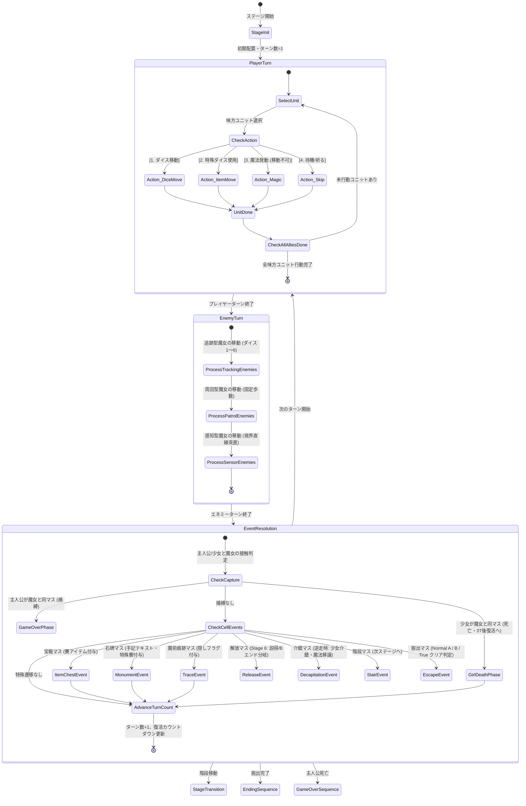

# 基本設計書：ゲーム進行・ターン制御フロー設計書

本書は、「すごろく×魔女の館脱出ゲーム」におけるターン進行ステートマシン、プレイヤーターン・エネミーターンの制御フロー、およびイベント解決フェーズの基本設計書である。実装後の**結合テスト仕様書（ゲームロジック・ターン進行テスト）**へそのまま転用できる構成で記述する。

---

## 1. ターン進行ステートマシン (TurnManager)

ゲームの1ターンは、以下の3フェーズが直列にループするステートマシンとして動作する。

---

## 2. プレイヤーターン詳細制御仕様

### (1) 味方ユニットの行動順序と管理
- そのステージに存在する味方ユニット（主人公、および同行少女）は、**任意の順番**で選択して行動できる。
- 各ユニットはターン開始時に `has_acted = false` となり、行動（移動・魔法・待機）を終えると `has_acted = true` になる。
- 全味方ユニットの `has_acted` が `true` になった時点で、自動的にプレイヤーターンが終了しエネミーターンへ移行する。

### (2) コマンド実行時の排他ルール
1. **ダイス移動 / アイテム移動：**
   - 通常ダイス（1〜6）またはアイテム選択による特殊ダイス（1〜6固定、意志の賽、双子の賽）で出目を決定。
   - 出目分だけグラフ経路に沿ってコマを進める（分岐がある場合はプレイヤーが方向を選択）。
   - 移動完了後、そのユニットは行動終了となる。
2. **魔法発動（移動不可）：**
   - 魔法コマンドを選択した場合、移動は行えない（出目0扱い・移動フェーズをスキップ）。
   - 各魔法の効果範囲に対象を指定して発動。
   - 発動完了後、そのユニットは行動終了となる。
3. **待機（祈る）：**
   - 現在のマスから動かず、魔法も使わずにそのターンをパスする。

---

## 3. エネミーターン詳細制御仕様

エネミー（魔女）は以下の3タイプのAIアルゴリズムに従い、順次処理される。

| タイプ | 移動決定ロジック | 行動順・優先度 |
| :--- | :--- | :--- |
| **追跡型** | 毎ターンダイス（1〜6）を振り、グラフ上の最短経路アルゴリズム（Dijkstra / A*）で主人公の現在地に向けて出目分前進する。 | 優先度1（最初に行動） |
| **周回型** | あらかじめ設定された固定マスリスト（例: マスA → B → C → B → A）を毎ターン固定歩数（例: 2マス）で規則正しく巡回する。ダイスは振らない。 | 優先度2（2番目に行動） |
| **感知型** | 自身の現在地から直線上の視界（一定マス以内）に主人公が入っているかを走査。感知した場合、ダイスを振らずに直線的に急接近（視界内の直線最大歩数移動）。感知しない場合は待機または1マス巡回。 | 優先度3（最後に行動） |

---

## 4. イベント解決フェーズ詳細制御仕様

全エネミーの移動完了後、盤面のマス状態およびキャラクター間の重なり判定を一括処理する。

### (1) 接触判定（捕縛・死亡）
1. **主人公 ＝ 魔女：**
   - 即座にゲームオーバー演出へ移行。
   - 少女の死亡やマスイベントの処理は中断される。
2. **少女 ＝ 魔女（主人公は別マス）：**
   - 少女は殺害され、盤面から一時退場。
   - 復活タイマー `revive_turn_count = 3` がセットされる。
   - ターンカウントが進むごとにデクリメントされ、0になったターンの開始時に初期配置マスに再出現する。

### (2) マスイベント判定
同マスに到達・停止した際のイベント処理：
- **宝箱マス：** ランダムな賽アイテム（1〜6の賽）を共通インベントリに1個追加。マスは使用済み状態（空き箱）へ変化。
- **石碑マス：** 石碑テキストダイアログを表示。読了後、特定の賽アイテム（意志の賽 / 双子の賽等）を付与。石碑既読フラグをON。
- **魔術の痕跡マス：** 隠し手記テキストを表示。該当ステージの「痕跡回収フラグ」をONにする。
- **解放マス（Stage 6）：**
  - 全痕跡フラグが未達成の場合：少女4人合流イベント発生 → Normal End Bへのルート確定。
  - 全痕跡フラグ達成済みの場合：説得ダイアログ発生 → 逆走ルート突入（Stage 5階段への進行許可）。
- **介錯マス（逆走時）：**
  - 該当属性の少女を同乗させた状態で到達した場合、介錯イベント（暗転・陶器破壊音）が発生。
  - 少女が消滅し、主人公の `acquired_magic_list` に該当魔法を追加。
- **階段マス：** 次のフロア（逆走時は前のフロア）への遷移確認ダイアログを表示。
- **脱出マス：**
  - Stage 6裏口：主人公単身なら Normal End A、5人なら Normal End B。
  - Stage EX正門：魔女殺害後、正門マスへ到達すると True End。

---

## 5. 結合テスト仕様への転用観点（ターン・進行テスト）

| テスト項目ID | テスト対象 | 入力・事前条件 | 期待される判定・処理結果 |
| :--- | :--- | :--- | :--- |
| **IT-TRN-001** | プレイヤーターン | 味方Aが移動完了、味方Bが未行動 | プレイヤーターンが継続し、味方Bを選択できること |
| **IT-TRN-002** | プレイヤーターン | 味方全員が行動（移動または魔法）完了 | 自動的にエネミーターンへ移行すること |
| **IT-TRN-003** | 魔法コスト | 味方ユニットが魔法を発動 | そのターンの移動が無効化され、即座に行動済みとなること |
| **IT-TRN-004** | 追跡型エネミー | 追跡型魔女のターン | ダイスが1〜6でロールされ、主人公への最短経路に沿って正確に出目分進むこと |
| **IT-TRN-005** | 感知型エネミー | 感知型の直線視界内に主人公が進入 | 感知フラグが立ち、主人公方向へ直線突進移動すること |
| **IT-TRN-006** | 捕縛判定 | 魔女が主人公と同一マスに停止 | 主人公捕縛フラグが立ち、暗転ゲームオーバーシーケンスへ遷移すること |
| **IT-TRN-007** | 少女復活判定 | 少女が魔女に捕縛されて3ターン経過 | 3ターン後のプレイヤーターン開始時に初期マスへ復活すること |
| **IT-TRN-008** | 介錯判定 | 逆走時、炎の少女と共にかまどマスへ到達 | 介錯イベントが発生し、少女消滅＋主人公に炎魔法フラグが付与されること |
| **IT-TRN-009** | 説得判定 | 全痕跡未回収でStage 6解放マス到達 | 説得イベントは発生せず、Normal B脱出フローへ移行すること |
| **IT-TRN-010** | 説得判定 | 全痕跡回収済みでStage 6解放マス到達 | 説得イベントが発生し、逆走ルート（Stage 5への退路）が解禁されること |
