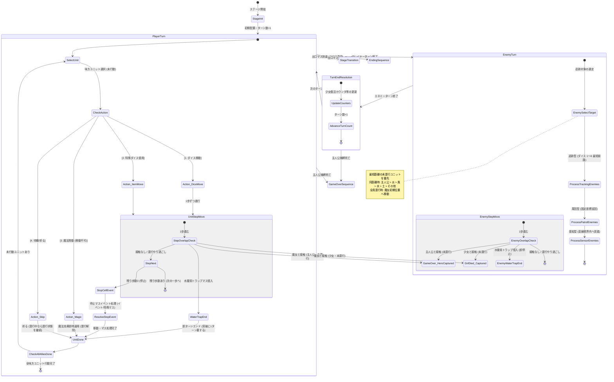

# 基本設計書：ゲーム進行・ターン制御フロー設計書

本書は、「すごろく×魔女の館脱出ゲーム」におけるターン進行ステートマシン、プレイヤーターン・エネミーターンの制御フロー、リアルタイム接触判定、およびマスイベント解決フェーズの基本設計書である。実装後の**結合テスト仕様書（ゲームロジック・ターン進行テスト）**へそのまま転用できる構成で記述する。

---

## 1. ターン進行ステートマシン (TurnManager)

ゲームの1ターンは、以下のフェーズが直列にループするステートマシンとして動作する。
接触判定（捕縛・死亡）はターン終了時の一括判定ではなく、**ユニットが1歩進むごとに即座に判定**される。

---

## 2. プレイヤーターン詳細制御仕様

### (1) 味方ユニットの行動順序と管理
- ステージ内の生存味方ユニット（主人公、および同行少女）は、**任意の順番**で選択して行動できる。
- 1回休み状態（`is_skipped = true`）のユニットは、そのターン選択不可となり自動的に行動終了となる（ターン終了時にフラグ解除）。
- 各ユニットはターン開始時に `has_acted = false` となり、行動（移動・魔法・待機）完了で `has_acted = true` になる。
- 全味方ユニットの行動完了で、自動的にエネミーターンへ移行する。

### (2) 1歩ごとの移動と接触・トラップ判定
1. **1歩ごとの接触（捕縛）判定：**
   - ユニットが1歩マスを進むごとに、同マスに存在する魔女との接触判定を行う。
   - **潜行中（`is_burrowed = true`）の場合：** 魔女と同マスになっても捕縛されず、そのまま通過または滞在できる（やり過ごし成功）。
   - **未潜行の場合：**
     - **主人公と魔女が重なった：** 即座に移動を中断し、画面暗転・捕縛SE再生を経てゲームオーバーシーケンスへ移行。
     - **少女と魔女が重なった：** 少女は即座に殺害されて盤面から一時退場。`revive_turn_count = 3` がセットされる。
2. **水魔術トラップの即時ターンエンド判定：**
   - 移動経路上のマスに水魔術トラップが存在する場合、足を踏み入れた瞬間に**残りの移動歩数に関わらず移動が強制終了し、そのユニットは行動完了（ターンエンド）**となる。
   - 次のターンに移動コマンドを選択することで水マスから脱出・進行できる（＝結果として突破に丸1ターンを要する）。

### (3) コマンド実行時の排他ルール
1. **ダイス移動 / アイテム移動：**
   - 通常ダイス（1〜6）または特殊ダイス（1〜6固定、意志の賽、双子の賽）で出目を決定し、1歩ずつ進行する。
   - **往復移動（折り返し）の許可：** 出目を消費する際、一直線に進むだけでなく「来たマスへ戻る（折り返し）」移動を許可する（例：出目6のとき、右2マス進んで左2マス戻り、さらに右2マス進む等）。これにより、出目が大きすぎて魔女の目前に強制突入してしまう事故や、目的マスを行き過ぎる理不尽なフラストレーションを防ぎ、プレイヤーの裁量で停止位置を調整できる。
   - ※ただし、1歩ごとの接触判定（移動途中のマスに魔女がいれば即捕縛）および水トラップ判定（途中で踏んだら即ターン終了）は各ステップごとに厳密に適用される。
   - 潜行中（`is_burrowed = true`）だったユニットが移動を選択した場合、**地上に出現して潜行解除（`is_burrowed = false`）**となる。
   - 移動完了後、そのユニットは行動終了となる。
2. **魔法発動（移動不可）：**
   - 魔法コマンドを選択した場合、移動は行えない（出目0扱い・移動フェーズスキップ）。
   - 潜行中のユニットが魔法を使用した場合も、地上に出現して潜行解除となる。
   - 各魔法の効果を発動：
     - **炎：** 射程2マス以内の魔女を一時撃破（2ターン後初期位置で復活）。
     - **水：** 射程内の指定マスに「永続水魔術トラップ」を生成。
     - **風：** 自身から上下左右の指定直線上の対象を、壁に遮られない最遠マスまで吹き飛ばす。
     - **土：** 自身または指定味方キャラを地中に潜らせる（`is_burrowed = true`）／魔女を指定した場合は1ターン行動不能にする。
   - 発動完了後、そのユニットは行動終了となる。
3. **待機（祈る）：**
   - 現在のマスから動かず、魔法も使わずにそのターンをパスする。
   - **潜行状態の継続仕様：** 潜行中（`is_burrowed = true`）のユニットが「祈る（待機）」を選択した場合、**潜行状態を解除せずそのまま維持（潜行継続）**する。

---

## 3. エネミーターン詳細制御仕様

### (1) 魔女のターゲット選定アルゴリズム
追跡型魔女および感知型魔女が狙う対象は、毎エネミーターンの開始時に以下のルールで決定される。

1. **候補の絞り込み：**
   - 盤面上に存在する「未潜行」かつ「生存中」の味方ユニット（主人公および少女たち）をターゲット候補とする。
   - **土魔法で地中に潜行中のユニットは魔女から感知されず、ターゲット候補から除外**される。
2. **最短距離優先：**
   - 魔女の現在地からグリッド上の最短経路距離（歩数）を計算し、**最も近いユニット**をターゲットとして選定する。
3. **同距離時のタイブレーク優先順位：**
   - 複数の味方ユニットが魔女から全く同じ距離にいる場合、以下の厳格な優先順位でターゲットを決定する：
     $$\text{主人公 (HERO)} > \text{炎の少女 (GIRL\_FIRE)} > \text{風の少女 (GIRL\_WIND)} > \text{水の少女 (GIRL\_WATER)} > \text{土の少女 (GIRL\_EARTH)} > \text{その他の魔法使い}$$
4. **全員潜行時の挙動：**
   - 盤面上の全味方ユニットが潜行中（または退場中）でターゲット候補が0名の場合：
     - 追跡型魔女は目標を見失い、**自身の初期配置座標（`initial_coord`）へ向けて最短経路で移動**しようとする（初期位置に到達している場合はその場で待機）。

### (2) エネミーの行動タイプと移動制御
エネミーは以下の3タイプに分かれ、順次行動する。エネミーも**1歩進むごとに味方との接触判定および水トラップ判定**を行う。

| タイプ | 移動決定ロジック | 行動順・優先度 |
| :--- | :--- | :--- |
| **追跡型** | 毎ターンダイス（1〜6）を振り、ターゲット（選定アルゴリズム準拠）への最短経路（A* / BFS）を出目分前進する。全員潜行時は自身の初期位置へ向かう。水トラップを踏んだ瞬間、残移動歩数に関わらずその場で停止・行動終了。 | 優先度1（最初に行動） |
| **周回型** | あらかじめ設定された固定巡回座標リストを毎ターン固定歩数（例: 2マス）で往復する。水トラップを踏んだ瞬間、その場で停止・行動終了。 | 優先度2（2番目に行動） |
| **感知型** | 自身の上下左右の直線上（一定マス以内）に未潜行の味方がいるか走査。感知した場合、直線的に急接近する（水トラップを踏んだら即停止）。感知しない場合は待機または小規模巡回。 | 優先度3（最後に行動） |

※土魔法で潜行（行動不能）状態にされたエネミーは、エネミーターンでの移動処理がスキップされる。
※エネミー移動時、捕縛や少女殺害等のイベントが発生しない通常移動であれば、演出スキップ設定（または画面クリック）によりTween演出を省略し、一瞬で全エネミーの移動を完了させて即座にプレイヤーターンへ復帰する。

---

## 4. 停止マスイベント解決仕様

ユニットが移動を完了し、マス上に最終停止した際に発生するイベント処理。

### (1) 出口マス (`EXIT`)
- 通常フロア：次フロアへの階段移動確認ダイアログを表示し、次ステージへ遷移。
- 最終フロア（Stage 6裏口 / Stage EX正門）：脱出完了ダイアログを表示し、対応するエンディングシーケンスへ遷移。

### (2) イベントマス (`EVENT`)
マスに設定された `event_id` に応じて以下のイベントを汎用実行する：
- **宝箱イベント：** ランダムな賽アイテムを共通インベントリに付与。マスは取得済み（消費済み）に変化。
- **石碑イベント：** 手記テキストを表示＋特殊賽を付与。石碑既読フラグをON。
- **魔術痕跡イベント：** 隠し手記テキストを表示＋痕跡回収フラグをON。
- **儀式解放イベント（Stage 6）：** 全痕跡回収時は説得・逆走ルート解禁、未回収時はNormal End Bへ分岐。
- **介錯イベント（逆走時）：** 対応する少女同行時、介錯演出（暗転・陶器破壊音）を経て少女成仏＋主人公に魔法定着。

### (3) すごろく特殊マス
- **追加移動マス (`ADDITIONAL_MOVE`)：** 指定歩数（例: +2歩）の追加移動権を得る。任意方向へ進み、停止先のマスイベントも通常通り連鎖発動する。
- **振り出しマス (`RETURN_TO_START`)：** そのステージのスタート初期位置へ強制送還される。
- **1回休みマス (`SKIP_TURN`)：** 次ターンの行動不能フラグ（`is_skipped = true`）が付与される。
- **もう一度マス (`ROLL_AGAIN`)：** 即座にプレイヤーターンが再開され、もう一度ダイスを振って移動できる。

---

## 5. 結合テスト仕様への転用観点（ターン・進行テスト）

| テスト項目ID | テスト対象 | 入力・事前条件 | 期待される判定・処理結果 |
| :--- | :--- | :--- | :--- |
| **IT-TRN-001** | プレイヤーターン | 味方Aが移動完了、味方Bが未行動 | プレイヤーターンが継続し、味方Bを選択できること |
| **IT-TRN-002** | プレイヤーターン | 味方全員が行動完了 | 自動的にエネミーターンへ移行すること |
| **IT-TRN-003** | 魔法コスト | 味方ユニットが魔法を発動 | そのターンの移動が無効化され、即座に行動済みとなること |
| **IT-TRN-004** | 水トラップ即時停止 | 移動途中のユニットが水魔術トラップに侵入 | 残り歩数に関わらずそのマスで強制停止しターン終了となること |
| **IT-TRN-005** | 水トラップ突破 | 水魔術トラップ上で次ターンに移動コマンド実行 | 通常通り出目分移動して水マスから脱出できること（計1ターン足止め） |
| **IT-TRN-006** | 土潜行中の祈る | 潜行中の味方ユニットが「祈る」コマンドを選択 | 潜行状態（`is_burrowed = true`）を解除せず継続できること |
| **IT-TRN-007** | 土潜行中の移動 | 潜行中の味方ユニットが「ダイス移動」を選択 | 地上に出現して潜行解除（`is_burrowed = false`）となり移動すること |
| **IT-TRN-008** | リアルタイム接触 | 移動中の主人公が魔女のいるマスを通過しようとする | 通過できず、1歩足を踏み入れた瞬間に即座に捕縛ゲームオーバーとなること |
| **IT-TRN-009** | 魔女ターゲット選定 | 魔女から主人公（3マス）、炎少女（2マス） | より距離が近い炎少女をターゲットとして最短追跡すること |
| **IT-TRN-010** | 魔女ターゲット同距離 | 魔女から主人公（2マス）、炎少女（2マス） | 優先順位（主人公 > 炎少女）に従い、主人公をターゲットとすること |
| **IT-TRN-011** | 全員潜行時魔女AI | 全生存味方が土魔法で潜行中 | 追跡魔女がターゲットを見失い、自身の初期位置へ向けて移動すること |
| **IT-TRN-012** | イベントマス実行 | 宝箱/石碑等の `EVENT` マスに停止 | `event_id` に応じた固有イベント（アイテム付与/手記表示等）が正常実行されること |
| **IT-TRN-013** | 出口マス判定 | `EXIT` マスに停止 | フロアの種別に応じて階段移動または脱出シーケンスへ正しく遷移すること |
| **IT-TRN-014** | 追加移動マス連鎖 | 追加移動マスに停止後、EVENTマスへ移動 | 追加移動が実行され、移動先のEVENTマス処理が連鎖して発動すること |
| **IT-TRN-015** | 往復移動（折り返し） | 出目消費中に来たマスへ戻る移動経路を選択 | 折り返し移動が成立し、移動途中の接触判定・水トラップ判定が各歩ごとに実行されること |
