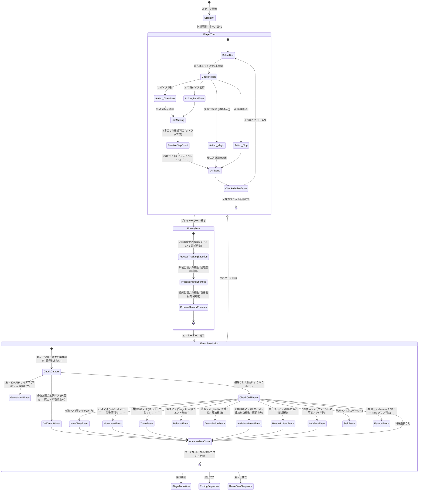

# 基本設計書：ゲーム進行・ターン制御フロー設計書

本書は、「すごろく×魔女の館脱出ゲーム」におけるターン進行ステートマシン、プレイヤーターン・エネミーターンの制御フロー、およびイベント解決フェーズの基本設計書である。実装後の**結合テスト仕様書（ゲームロジック・ターン進行テスト）**へそのまま転用できる構成で記述する。

---

## 1. ターン進行ステートマシン (TurnManager)

ゲームの1ターンは、以下の3フェーズが直列にループするステートマシンとして動作する。

---

## 2. プレイヤーターン詳細制御仕様

### (1) 味方ユニットの行動順序と管理
- ステージ内の生存味方ユニット（主人公、および同行少女）は、**任意の順番**で選択して行動できる。
- 1回休み状態（`is_skipped = true`）のユニットは、そのターン選択不可となり自動的に行動終了となる（ターン終了時にフラグ解除）。
- 各ユニットはターン開始時に `has_acted = false` となり、行動（移動・魔法・待機）完了で `has_acted = true` になる。
- 全味方ユニットの行動完了で、自動的にエネミーターンへ移行する。

### (2) コマンド実行時の排他ルール
1. **ダイス移動 / アイテム移動：**
   - 通常ダイス（1〜6）または特殊ダイス（1〜6固定、意志の賽、双子の賽）で出目を決定。
   - グリッドの接続（上下左右）に沿ってプレイヤーが進行方向を選択しながら進む。
   - **水魔術トラップの通過判定：** 移動経路上に水魔術トラップが存在する場合、そのマスを通過するのに**追加で1歩分を消費**する。出目が足りない場合はそのマスで強制停止となる。
   - 移動完了後、そのユニットは行動終了となる。
2. **魔法発動（移動不可）：**
   - 魔法コマンドを選択した場合、移動は行えない（出目0扱い・移動フェーズスキップ）。
   - 各魔法の効果を発動：
     - **炎：** 射程2マス以内の魔女を一時撃破（2ターン後初期位置で復活）。
     - **水：** 射程内の指定マスに「永続水魔術トラップ」を生成。
     - **風：** 自身から上下左右の指定直線上の対象を、壁に遮られない最遠マスまで吹き飛ばす。
     - **土：** 自身または指定キャラを地中に潜らせる（味方：1ターンやり過ごし / 魔女：1ターン行動不能）。
   - 発動完了後、そのユニットは行動終了となる。
3. **待機（祈る）：**
   - 現在のマスから動かず、魔法も使わずにそのターンをパスする。

---

## 3. エネミーターン詳細制御仕様

エネミー（魔女）は以下の3タイプのAIアルゴリズムに従い、順次処理される。

| タイプ | 移動決定ロジック | 行動順・優先度 |
| :--- | :--- | :--- |
| **追跡型** | 毎ターンダイス（1〜6）を振り、2Dグリッド上の最短経路（A* / BFS）で主人公の現在座標に向けて出目分前進する。水魔術トラップを踏むと1歩余分に消費する。 | 優先度1（最初に行動） |
| **周回型** | あらかじめ設定された固定巡回座標リストを毎ターン固定歩数（例: 2マス）で規則正しく往復する。ダイスは振らない。水魔術トラップを踏むと移動歩数が減衰する。 | 優先度2（2番目に行動） |
| **感知型** | 自身の現在座標から上下左右の直線上（一定マス以内）に主人公がいるかを走査。感知した場合、ダイスを振らずに直線的に急接近する。感知しない場合は待機または小規模巡回。 | 優先度3（最後に行動） |

※土魔法で潜行（行動不能）状態のエネミーは、エネミーターンでの移動処理がスキップされる。

---

## 4. イベント解決フェーズ詳細制御仕様

全エネミーの移動完了後、盤面のマス状態およびキャラクター間の重なり判定を一括処理する。

### (1) 接触判定（捕縛・死亡・潜行やり過ごし）
1. **潜行状態のチェック：**
   - 主人公または少女が `is_burrowed = true`（土魔法で潜行中）の場合、**魔女と同じマスに存在しても捕縛されない（やり過ごし成功）**。
2. **通常接触判定（未潜行時）：**
   - **主人公 ＝ 魔女：** 即座に画面暗転・捕縛SE再生を経てゲームオーバーシーケンスへ移行。
   - **少女 ＝ 魔女（主人公は別マス）：** 少女は殺害され盤面から一時退場。`revive_turn_count = 3` がセットされる（ターン経過でデクリメントされ、0で初期配置マスに復活）。

### (2) マスイベント判定（連鎖移動ルール）
同マスに到達・停止した際のイベント処理：
- **追加移動マス (`ADDITIONAL_MOVE`)：**
  - 指定歩数（例: +2歩）の追加移動権を得る。プレイヤーが任意に方向を選択して移動し、**移動先で停止したマスイベントも通常通り連鎖して発動**する。
- **振り出しマス (`RETURN_TO_START`)：**
  - そのステージのスタート初期座標へ強制送還される。
- **1回休みマス (`SKIP_TURN`)：**
  - 次ターンの行動不能フラグ（`is_skipped = true`）が付与される。
- **もう一度マス (`ROLL_AGAIN`)：**
  - 即座にプレイヤーターンが再開され、もう一度ダイスを振って移動できる。
- **宝箱マス (`ITEM_CHEST`)：** ランダムな賽アイテムを共通インベントリに1個追加。マスは使用済みへ変化。
- **石碑マス (`MONUMENT`)：** 手記テキスト表示＋特殊賽付与。石碑既読フラグON。
- **魔術の痕跡マス (`MAGIC_TRACE`)：** 隠し手記テキスト表示＋痕跡回収フラグON。
- **解放マス (`RELEASE`)（Stage 6）：** 全痕跡回収時は説得・逆走突入、未回収時はNormal End B確定。
- **介錯マス (`DECAPITATION`)（逆走時）：** 該当少女同行時、介錯イベント（暗転・陶器破壊音）発生。少女成仏＋主人公に魔法定着。
- **階段マス (`STAIRS`)：** 次フロアへの遷移確認ダイアログ表示。
- **脱出マス (`ESCAPE`)：** Stage 6裏口（Normal A/B）または Stage EX正門（True End）の脱出処理。

---

## 5. 結合テスト仕様への転用観点（ターン・進行テスト）

| テスト項目ID | テスト対象 | 入力・事前条件 | 期待される判定・処理結果 |
| :--- | :--- | :--- | :--- |
| **IT-TRN-001** | プレイヤーターン | 味方Aが移動完了、味方Bが未行動 | プレイヤーターンが継続し、味方Bを選択できること |
| **IT-TRN-002** | プレイヤーターン | 味方全員が行動（移動または魔法）完了 | 自動的にエネミーターンへ移行すること |
| **IT-TRN-003** | 魔法コスト | 味方ユニットが魔法を発動 | そのターンの移動が無効化され、即座に行動済みとなること |
| **IT-TRN-004** | 水トラップ遅延 | 追跡型魔女が水魔術マスを通過 | 移動歩数が1歩余分に消費され、遅延が発生すること |
| **IT-TRN-005** | 風魔法吹き飛ばし | 直線上のエネミーへ風魔法発動 | エネミーが壁に遮られない最遠マスまで吹き飛ばされること |
| **IT-TRN-006** | 土潜行やり過ごし | 主人公が潜行状態で魔女と同マスに停止 | 捕縛判定が発生せず、安全に生存が継続すること |
| **IT-TRN-007** | 追加移動マス連鎖 | 追加移動マスに停止後、宝箱マスへ移動 | 追加移動が実行され、移動先の宝箱イベントが連鎖して発動すること |
| **IT-TRN-008** | 少女復活判定 | 少女が魔女に捕縛されて3ターン経過 | 3ターン後のプレイヤーターン開始時に初期マスへ復活すること |
| **IT-TRN-009** | 介錯判定 | 逆走時、炎の少女と共にかまどマスへ到達 | 介錯イベントが発生し、少女消滅＋主人公に炎魔法フラグが付与されること |
| **IT-TRN-010** | 説得判定 | 全痕跡回収済みでStage 6解放マス到達 | 説得イベントが発生し、逆走ルート（Stage 5への退路）が解禁されること |
