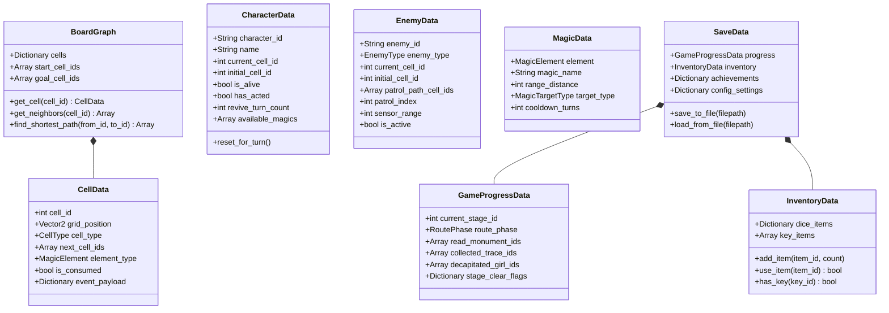

# 基本設計書：データ構造およびモデル設計書

本書は、「すごろく×魔女の館脱出ゲーム」（Godot Engine 4 / GDScript）におけるデータモデル、リソース定義、セーブデータ構造、および状態管理の基本設計書である。実装後の**結合テスト仕様書（データモデル・永続化テスト）**へそのまま転用できる構成で記述する。

---

## 1. クラス・リソース全体構成図 (Godot 4)



---

## 2. データモデル詳細仕様

### (1) マスデータモデル (`CellData`)
Godotの `Resource` として定義。盤面の1マスを表現する。

```gdscript
class_name CellData
extends Resource

enum CellType {
    NORMAL,          # 通常マス
    ITEM_CHEST,      # 宝箱マス (賽アイテム入手)
    MONUMENT,        # 石碑マス (手記テキスト・特殊賽)
    MAGIC_TRACE,     # 魔術の痕跡マス (True End用隠しフラグ)
    RELEASE,         # 解放マス (Stage 6: 儀式の楔)
    DECAPITATION,    # 介錯マス (炎・水・風・土の死因現場)
    STAIRS,          # 階段マス (フロア移動)
    ESCAPE           # 脱出マス (裏口 / 正門)
}

enum MagicElement {
    NONE,
    FIRE,   # 炎 (キッチン: 焼却炉/大かまど)
    WATER,  # 水 (庭園: 古井戸)
    WIND,   # 風 (別邸・時計塔: 鐘楼)
    EARTH   # 土 (地下室: 墓穴)
}

@export var cell_id: int
@export var grid_position: Vector2
@export var cell_type: CellType = CellType.NORMAL
@export var next_cell_ids: Array[int] = []
@export var element_type: MagicElement = MagicElement.NONE
@export var is_consumed: bool = false
@export var event_payload: Dictionary = {}
```

---

### (2) キャラクターデータモデル (`CharacterData`)
主人公および同行少女（味方ユニット）の共通モデル。

```gdscript
class_name CharacterData
extends Resource

@export var character_id: String
@export var name: String
@export var current_cell_id: int
@export var initial_cell_id: int
@export var is_alive: bool = true
@export var has_acted: bool = false
@export var revive_turn_count: int = 0
@export var available_magics: Array[CellData.MagicElement] = []

func reset_for_turn() -> void:
    if is_alive:
        has_acted = false
    elif revive_turn_count > 0:
        revive_turn_count -= 1
        if revive_turn_count == 0:
            is_alive = true
            current_cell_id = initial_cell_id
            has_acted = false
```

---

### (3) エネミーデータモデル (`EnemyData`)
各フロアを徘徊する魔女のモデル。

```gdscript
class_name EnemyData
extends Resource

enum EnemyType {
    TRACKING,  # 追跡型: ダイス1〜6で最短距離追跡
    PATROL,    # 周回型: 固定ルートを固定歩数で往復
    SENSOR     # 感知型: 直線視界内の主人公へ急接近
}

@export var enemy_id: String
@export var enemy_type: EnemyType
@export var current_cell_id: int
@export var initial_cell_id: int
@export var patrol_path_cell_ids: Array[int] = []
@export var patrol_index: int = 0
@export var sensor_range: int = 4
@export var is_active: bool = true
```

---

### (4) インベントリ・アイテムデータモデル (`InventoryData`)
味方全体で共有するアイテム管理モデル。

```gdscript
class_name InventoryData
extends Resource

# キー: "DICE_1"〜"DICE_6", "DICE_WILL", "DICE_TWIN"
# 値: 所持個数 (int)
@export var dice_items: Dictionary = {}

# 所持キーアイテムリスト: "KEY_LIBRARY" (書斎の鍵), "KEY_MAIN_GATE" (正門の鍵)
@export var key_items: Array[String] = []

func add_dice_item(item_id: String, count: int = 1) -> void:
    dice_items[item_id] = dice_items.get(item_id, 0) + count

func use_dice_item(item_id: String) -> bool:
    if dice_items.get(item_id, 0) > 0:
        dice_items[item_id] -= 1
        return true
    return false

func has_key(key_id: String) -> bool:
    return key_items.has(key_id)
```

---

### (5) ゲーム進行・セーブデータモデル (`SaveData`)
ステージの進行状況、フラグ、実績、コンフィグ設定を包括する永続化データ。

```gdscript
class_name SaveData
extends Resource

enum RoutePhase {
    FORWARD,     # 順走 (Stage 1〜6)
    BACKTRACK,   # 逆走 (Stage 5〜1)
    CLIMAX_EX    # Stage EX エントランス最終決戦
}

@export var current_stage_id: int = 1
@export var route_phase: RoutePhase = RoutePhase.FORWARD
@export var read_monument_ids: Array[String] = []
@export var collected_trace_ids: Array[String] = []  # 全4箇所回収で説得成功
@export var decapitated_girl_ids: Array[String] = [] # 介錯済み少女
@export var stage_clear_flags: Dictionary = {}      # 再探索用ステージ解放状態

@export var inventory: InventoryData = InventoryData.new()

# 実績解除状態 (キー: 実績ID, 値: 解除日時文字列)
@export var achievements: Dictionary = {}

# コンフィグ設定
@export var config_settings: Dictionary = {
    "master_volume": 0.8,
    "bgm_volume": 0.7,
    "se_volume": 0.8,
    "text_speed": 1.0,
    "fullscreen": false
}
```

---

## 3. 結合テスト仕様への転用観点（データモデル・永続化テスト）

| テスト項目ID | テスト対象 | 入力・実行条件 | 期待されるデータ状態 |
| :--- | :--- | :--- | :--- |
| **IT-DAT-001** | `BoardGraph` | マスIDと接続先IDを登録 | `get_neighbors(id)` で隣接ノードが正しく取得でき、無効IDで安全に空配列が返ること |
| **IT-DAT-002** | `BoardGraph` | 任意2マス間の最短経路検索 | 最短ステップ数のセルID配列が正しく返ること（A* / Dijkstra検証） |
| **IT-DAT-003** | `CharacterData` | `revive_turn_count=3` でターン更新を3回実行 | 3回目で `is_alive=true`、位置が `initial_cell_id` へ復帰すること |
| **IT-DAT-004** | `EnemyData` | 周回型エネミーの移動 | `patrol_path_cell_ids` のインデックス順に巡回し、端で正しく折り返すこと |
| **IT-DAT-005** | `InventoryData` | 賽アイテム追加と消費 | 1個所持状態で `use_dice_item` 実行時、残数が0となり `true` が返ること。残数0で `false` が返ること |
| **IT-DAT-006** | `SaveData` | ステージクリア・痕跡回収状態で保存 | `ResourceSaver.save` でファイル出力され、ロード後に全フラグとアイテムが同一値で復元されること |
| **IT-DAT-007** | ステージ再探索 | ステージクリア後にクリア済みステージを選択 | 所持消費アイテム（`dice_items`）が保持されたまま、該当ステージが初期化されること |
