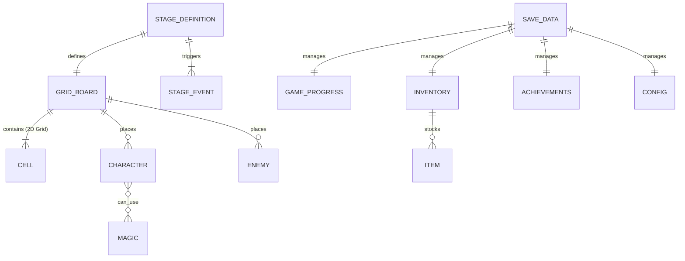

# 基本設計書：データ構造およびモデル設計書

本書は、「すごろく×魔女の館脱出ゲーム」における概念データモデル、各エンティティの責務・属性一覧、データ関連図、および永続化方針を定義した基本設計書である。実装言語（GDScript）の個別コードや関数実装には踏み込まず、論理データ構造および**結合テスト仕様書（データ整合性テスト）**へ転用できる構成で記述する。

---

## 1. 概念データモデル関連図 (Entity Relationship)

---

## 2. エンティティ定義および属性仕様

### (1) 2次元グリッド盤面 (`GridBoard`)
- **責務：** ステージ内のマス目を2次元座標空間（`x, y`）上に配置し、上下左右の隣接接続、直線走査（風魔法・感知型エネミー視界）、および最短経路探索を提供する。
- **管理データ項目：**
  | 項目名（論理） | 項目名（物理） | データ型概要 | 説明 |
  | :--- | :--- | :--- | :--- |
  | グリッドマップ | `cells_map` | 座標辞書 (x,y → Cell) | 2次元整数座標に対応するマス情報のマッピング |
  | 盤面幅・高さ | `grid_size` | 2D整数サイズ (w, h) | マップ全体のグリッド寸法 |
  | スタート座標 | `start_coord` | 2D整数座標 | 味方の初期スタート地点 |
  | 出口座標 | `exit_coord` | 2D整数座標 | ステージクリア・階段移動・脱出地点 |

---

### (2) マス (`Cell`)
- **責務：** 盤面上の1マスを表現し、マスの種類、上下左右の接続先、イベント識別子、消費状態を保持する。
- **データ項目一覧：**
  | 項目名（論理） | 項目名（物理） | データ型概要 | 説明 |
  | :--- | :--- | :--- | :--- |
  | グリッド座標 | `coord` | 2D整数座標 (x, y) | 盤面内での絶対グリッド位置 |
  | マスID | `cell_id` | 整数 | 一意のマス識別番号 |
  | マス種別 | `cell_type` | 列挙型 | 下記参照（通常、出口、イベント、特殊、水トラップ） |
  | 隣接接続情報 | `connections` | 4方向辞書 (Up, Down, Left, Right → bool) | 壁や障害物で遮られていない通行可能な方向 |
  | イベントID | `event_id` | 文字列 | `EVENT` マスで発動するイベント識別子（宝箱、石碑、痕跡、解放、介錯等） |
  | 属性属性 | `element_type` | 列挙型 | なし、炎、水、風、土（介錯イベント等で使用） |
  | 消費済みフラグ | `is_consumed` | 真偽値 | 宝箱等、1度しか発動しないマスの取得済み状態 |
  | イベントパラメータ | `event_params` | 辞書型 | 追加移動歩数などの付加パラメータ |

#### ■ マス種別 (`CellType`) 一覧
マス種別は乱立させず、責務ごとに集約・整理されている。

1. **通常マス (`NORMAL`)：** 何も起きない基本マス。
2. **出口マス (`EXIT`)：** 次フロアへの階段移動、またはステージクリア／館脱出を行うマス（旧階段・脱出マスを統合）。
3. **イベントマス (`EVENT`)：** 宝箱、石碑、魔術の痕跡、儀式解放、介錯など、各種イベントが発生するマス。マスに紐づく `event_id` により実行内容を識別・処理する（旧個別イベントマスを統合）。
4. **追加移動マス (`ADDITIONAL_MOVE`)：** 指定歩数（例: +2歩）の追加移動権を得るマス。プレイヤーが進行方向を任意選択して進み、停止先マスイベントも連鎖判定される。
5. **振り出しマス (`RETURN_TO_START`)：** スタート初期位置へ強制送還されるマス。
6. **1回休みマス (`SKIP_TURN`)：** 拘束の蔦や恐怖により、次ターンが行動不能になるマス。
7. **もう一度マス (`ROLL_AGAIN`)：** 移動後、即座にダイスを追加で振れるボーナスマス。
8. **水魔術トラップ (`WATER_TRAP`)：** 水の魔法で生成される永続地形トラップ。侵入した瞬間に残移動数に関わらずターンエンドとなり、突破に1ターン要する。

---

### (3) キャラクター（味方ユニット） (`Character`)
- **責務：** 主人公および同行少女たちの現在地、行動状態、潜行状態、使用可能魔法を管理する。
- **データ項目一覧：**
  | 項目名（論理） | 項目名（物理） | データ型概要 | 説明 |
  | :--- | :--- | :--- | :--- |
  | キャラクターID | `character_id` | 文字列 | 主人公 (`HERO`)、炎の少女 (`GIRL_FIRE`) などの識別子 |
  | キャラクター名 | `name` | 文字列 | UI表示用の名前 |
  | 現在グリッド座標 | `current_coord` | 2D整数座標 (x, y) | 現在滞在しているグリッド位置 |
  | 初期グリッド座標 | `initial_coord` | 2D整数座標 (x, y) | ステージ開始時の初期位置（復活時にも使用） |
  | 生存フラグ | `is_alive` | 真偽値 | 生存中か否か |
  | 行動済みフラグ | `has_acted` | 真偽値 | そのターンの行動（移動/魔法/待機）完了状態 |
  | 復活カウンタ | `revive_turn_count` | 整数 | 魔女に捕縛された後の復活残りターン数（初期値3） |
  | 潜行フラグ | `is_burrowed` | 真偽値 | 土魔法により地中に潜っているか（「祈る」で継続、移動・魔法使用で解除） |
  | 休みフラグ | `is_skipped` | 真偽値 | 1回休みマスを踏んだことによる行動不能状態 |
  | 習得済み魔法一覧 | `available_magics` | 属性配列 | 自身が行使可能な魔法属性のリスト |

---

### (4) エネミー（魔女） (`Enemy`)
- **責務：** 館内を徘徊する魔女の行動種別（追跡・周回・感知）、現在地、巡回経路を管理する。
- **データ項目一覧：**
  | 項目名（論理） | 項目名（物理） | データ型概要 | 説明 |
  | :--- | :--- | :--- | :--- |
  | エネミーID | `enemy_id` | 文字列 | 魔女個体の識別子 |
  | 行動タイプ | `enemy_type` | 列挙型 | 追跡型（最短追跡）、周回型（固定往復）、感知型（直線急接近） |
  | 現在グリッド座標 | `current_coord` | 2D整数座標 (x, y) | 現在滞在しているグリッド位置 |
  | 初期グリッド座標 | `initial_coord` | 2D整数座標 (x, y) | ステージ開始時の初期配置位置（全員潜行時の移動先） |
  | 巡回座標リスト | `patrol_coords` | 座標配列 | 周回型が辿る固定グリッド座標の巡回シーケンス |
  | 巡回インデックス | `patrol_index` | 整数 | 現在の巡回目標地点のインデックス |
  | 感知有効距離 | `sensor_range` | 整数 | 感知型が直線上で味方を検知できる最大グリッド数 |
  | 行動不能フラグ | `is_incapacitated` | 真偽値 | 土魔法で埋められたことによる1ターン休み状態 |
  | 稼働状態フラグ | `is_active` | 真偽値 | 炎の魔法等で一時撃破された際の停止・復活待機管理 |

---

### (5) ステージ定義データ (`StageDefinition`)（順走・逆走の完全分離）
- **責務：** ステージ固有の盤面グリッド、初期配置、登場エネミー、イベントを包括定義する。順走と逆走で別リソースファイルとして分離管理する。
- **データ項目一覧：**
  | 項目名（論理） | 項目名（物理） | データ型概要 | 説明 |
  | :--- | :--- | :--- | :--- |
  | ステージID | `stage_id` | 文字列 | `Stage2_Kitchen_Forward` / `Stage2_Kitchen_Backtrack` 等 |
  | 進行方向 | `direction` | 列挙型 | 順走 (`FORWARD`) または 逆走 (`BACKTRACK`) |
  | グリッド盤面データ | `board_data` | GridBoard | そのステージの全マス・接続定義 |
  | 初期配置リスト | `initial_placements` | 配置辞書 | 主人公、同行少女、魔女たちの初期配置座標 |
  | エネミー一覧 | `enemies` | Enemy配列 | そのステージに出現する魔女エネミーの設定リスト |
  | イベントマスター辞書 | `stage_events` | 辞書型 (event_id → 設定) | 宝箱、石碑、痕跡、解放、介錯などのイベント実体定義 |

---

### (6) 共通インベントリ (`Inventory`)
- **責務：** 味方全体で共有する消費アイテム（ダイス類）およびキーアイテムの所持数を管理する。
- **データ項目一覧：**
  | 項目名（論理） | 項目名（物理） | データ型概要 | 説明 |
  | :--- | :--- | :--- | :--- |
  | 賽アイテム所持辞書 | `dice_items` | 辞書型 (ID→個数) | 「1の賽」〜「6の賽」、「意志の賽」、「双子の賽」の所持数 |
  | 所持キーアイテム一覧 | `key_items` | 文字列配列 | 「書斎の鍵」、「正門の鍵」などのフラグアイテム |

---

### (7) セーブデータ・ゲーム進行状態 (`SaveData` / `GameProgress`)
- **責務：** ゲーム進行度、到達フラグ、回収状況、実績、コンフィグ設定を包括して永続化する（**セーブはステージクリア時のみ実行**）。
- **データ項目一覧：**
  | 項目名（論理） | 項目名（物理） | データ型概要 | 説明 |
  | :--- | :--- | :--- | :--- |
  | 現在ステージID | `current_stage_id` | 文字列 | 現在攻略中（または直前クリア後）のステージ識別子 |
  | ゲームクリアフラグ | `is_game_cleared` | 真偽値 | 一度でもいずれかのエンディングに到達したか（ステージ選択画面の解禁フラグ） |
  | イベント進行フラグ | `event_flags` | 辞書型 (ID→bool) | 石碑手記、魔術痕跡などのイベント閲覧・回収フラグの一元管理 |
  | 介錯済み少女リスト | `decapitated_girl_ids` | 文字列配列 | 介錯を完了した少女の属性リスト |
  | ステージ解放フラグ | `stage_clear_flags` | 辞書型 | 各ステージのクリア状況（再探索モードでの出撃判定） |
  | 実績データ | `achievements` | 辞書型 | 解除済み実績IDと解除日時の記録 |
  | 設定データ | `config_settings` | 辞書型 | BGM/SE音量、テキスト表示速度、ウィンドウモード設定 |

---

## 3. 結合テスト仕様への転用観点（データモデル・整合性テスト）

| テスト項目ID | テスト対象 | 入力・実行条件 | 期待されるデータ状態 |
| :--- | :--- | :--- | :--- |
| **IT-DAT-001** | グリッド盤面 | 2D座標と上下左右接続の構築 | 4方向の隣接マスが正しく取得でき、壁で塞がれた方向へは進行不能と判定されること |
| **IT-DAT-002** | 風魔法・直線走査 | 任意座標から右方向へ直線走査 | 同一Y軸上で連続して繋がっている最遠のX座標マスが正しく特定されること |
| **IT-DAT-003** | 感知型魔女視界 | 魔女と未潜行ユニットが同一X軸かつ直線上に配置 | 魔女の感知フラグが真となり、壁に遮られた場合または潜行時は偽となること |
| **IT-DAT-004** | 土魔法潜行状態 | キャラクターに潜行効果を適用、「祈る」実行 | `is_burrowed=true` が維持され、魔女と同マスになっても捕縛判定が発生しないこと |
| **IT-DAT-005** | 特殊マス効果 | `RETURN_TO_START` / `SKIP_TURN` マス停止 | 初期座標への強制移動、および次ターンの `is_skipped=true` が正しく反映されること |
| **IT-DAT-006** | EVENTマス実行 | 任意の `EVENT` マス停止 | `event_id` に対応するイベント（宝箱/石碑/痕跡/介錯等）のデータ処理が正常に行われること |
| **IT-DAT-007** | ステージデータ分離 | 順走と逆走のステージデータ読込 | 同一エリア（キッチン等）であっても、スタート・出口座標や敵配置が完全に独立してロードされること |
| **IT-DAT-008** | セーブ＆ロード | アイテム・痕跡フラグ所持状態で保存 | ファイル出力後、再ロード時にすべての座標・フラグ・アイテムが完全に復元されること |
