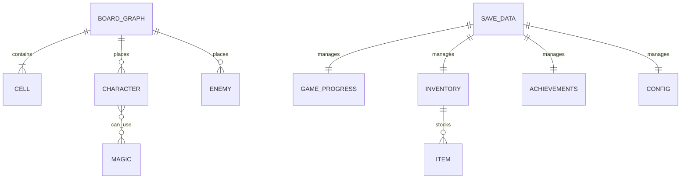

# 基本設計書：データ構造およびモデル設計書

本書は、「すごろく×魔女の館脱出ゲーム」における概念データモデル、各エンティティの責務・属性一覧、データ関連図、および永続化方針を定義した基本設計書である。実装言語（GDScript）の個別コードや関数実装には踏み込まず、論理データ構造および**結合テスト仕様書（データ整合性テスト）**へ転用できる構成で記述する。

---

## 1. 概念データモデル関連図 (ER / Entity Relationship)

---

## 2. エンティティ定義および属性仕様

### (1) 盤面グラフ (`BoardGraph`)
- **責務：** ステージ内の全マス目（ノード）と移動可能な経路（エッジ）を有向グラフ構造として管理し、移動可能性や最短経路を提供する。
- **管理データ項目：**
  - マスリスト（IDとマスのマッピング）
  - スタート地点マスID一覧
  - 脱出/階段マスID一覧

### (2) マス (`Cell`)
- **責務：** 盤面上の1マスを表現し、マスの種類、接続先、配置属性、イベント発生条件を保持する。
- **データ項目一覧：**
  | 項目名（論理） | 項目名（物理） | データ型概要 | 説明 |
  | :--- | :--- | :--- | :--- |
  | マスID | `cell_id` | 整数 | 盤面内で一意の識別番号 |
  | 盤面座標 | `position` | 2D座標 | 画面描画用のグリッドまたはピクセル座標 |
  | マス種別 | `cell_type` | 列挙型 | 通常、宝箱、石碑、魔術の痕跡、解放、介錯、階段、脱出 |
  | 接続先マス一覧 | `next_cell_ids` | 整数配列 | このマスから直接進行可能な次マスのIDリスト |
  | 属性属性 | `element_type` | 列挙型 | なし、炎、水、風、土（介錯マス等で使用） |
  | 消費済みフラグ | `is_consumed` | 真偽値 | 宝箱等、1度しか発動しないマスの取得済み状態 |
  | イベントペイロード | `event_payload` | 辞書型 | 石碑手記テキストID、宝箱抽選テーブル等の付加情報 |

---

### (3) キャラクター（味方ユニット） (`Character`)
- **責務：** 主人公および同行少女たちの現在位置、行動状態、死亡・復活カウント、使用可能魔法を管理する。
- **データ項目一覧：**
  | 項目名（論理） | 項目名（物理） | データ型概要 | 説明 |
  | :--- | :--- | :--- | :--- |
  | キャラクターID | `character_id` | 文字列 | 主人公 (`HERO`)、炎の少女 (`GIRL_FIRE`) などの識別子 |
  | キャラクター名 | `name` | 文字列 | UI表示用の名前 |
  | 現在マスID | `current_cell_id` | 整数 | 現在滞在しているマスのID |
  | 初期マスID | `initial_cell_id` | 整数 | 各ステージのスタート配置マス（復活時にも使用） |
  | 生存フラグ | `is_alive` | 真偽値 | 生存中か否か |
  | 行動済みフラグ | `has_acted` | 真偽値 | そのターンで行動（移動/魔法/待機）を完了したか |
  | 復活カウンタ | `revive_turn_count` | 整数 | 魔女に捕縛された後の復活残りターン数（初期値3） |
  | 習得済み魔法一覧 | `available_magics` | 属性配列 | 自身が行使可能な魔法属性のリスト |

---

### (4) エネミー（魔女） (`Enemy`)
- **責務：** 館内を徘徊する魔女の行動種別（追跡・周回・感知）、現在地、巡回経路を管理する。
- **データ項目一覧：**
  | 項目名（論理） | 項目名（物理） | データ型概要 | 説明 |
  | :--- | :--- | :--- | :--- |
  | エネミーID | `enemy_id` | 文字列 | 魔女個体の識別子 |
  | 行動タイプ | `enemy_type` | 列挙型 | 追跡型（ダイス最短追跡）、周回型（固定往復）、感知型（直線急接近） |
  | 現在マスID | `current_cell_id` | 整数 | 現在滞在しているマスのID |
  | 初期マスID | `initial_cell_id` | 整数 | ステージ開始時の初期配置マス |
  | 巡回マスリスト | `patrol_path` | 整数配列 | 周回型が辿る固定マスIDの巡回シーケンス |
  | 巡回インデックス | `patrol_index` | 整数 | 現在の巡回目標地点のインデックス |
  | 感知有効距離 | `sensor_range` | 整数 | 感知型が直線上で主人公を検知できる最大マス数 |
  | 稼働状態フラグ | `is_active` | 真偽値 | 炎の魔法等で一時撃破された際の停止・復活待機管理 |

---

### (5) 共通インベントリ (`Inventory`)
- **責務：** 味方全体で共有する消費アイテム（1〜6の賽、意志の賽、双子の賽）およびキーアイテム（書斎の鍵、正門の鍵）の所持数を管理する。
- **データ項目一覧：**
  | 項目名（論理） | 項目名（物理） | データ型概要 | 説明 |
  | :--- | :--- | :--- | :--- |
  | 賽アイテム所持辞書 | `dice_items` | 辞書型 (ID→個数) | 「1の賽」〜「6の賽」、「意志の賽」、「双子の賽」の所持数 |
  | 所持キーアイテム一覧 | `key_items` | 文字列配列 | 「書斎の鍵」、「正門の鍵」などのフラグアイテム |

---

### (6) セーブデータ・ゲーム進行状態 (`SaveData` / `GameProgress`)
- **責務：** 現在のステージ進行度、到達フラグ、回収状況、実績、コンフィグ設定を包括して永続化する。
- **データ項目一覧：**
  | 項目名（論理） | 項目名（物理） | データ型概要 | 説明 |
  | :--- | :--- | :--- | :--- |
  | 現在ステージID | `current_stage_id` | 整数 | 現在攻略中のステージ番号 (1〜6, EX) |
  | ルート進行フェーズ | `route_phase` | 列挙型 | 順走 (`FORWARD`)、逆走 (`BACKTRACK`)、決戦 (`CLIMAX_EX`) |
  | 石碑既読フラグ一覧 | `read_monument_ids` | 文字列配列 | 閲覧済みの石碑IDリスト（Normal End B条件） |
  | 魔術痕跡回収フラグ | `collected_trace_ids` | 文字列配列 | 発見した儀式研究メモIDリスト（True End説得条件） |
  | 介錯済み少女リスト | `decapitated_girl_ids` | 文字列配列 | 介錯を完了した少女の属性リスト |
  | ステージ解放フラグ | `stage_clear_flags` | 辞書型 | 各ステージのクリア状況（再探索モードでの出撃判定） |
  | 実績データ | `achievements` | 辞書型 | 解除済み実績IDと解除日時の記録 |
  | 設定データ | `config_settings` | 辞書型 | BGM/SE音量、テキスト表示速度、ウィンドウモード設定 |

---

## 3. 結合テスト仕様への転用観点（データモデル・永続化テスト）

| テスト項目ID | テスト対象 | 入力・実行条件 | 期待されるデータ状態 |
| :--- | :--- | :--- | :--- |
| **IT-DAT-001** | 盤面グラフ | マスと接続経路の構築 | 各マスの隣接ノードが正しく取得でき、グラフの循環・終端が意図通りであること |
| **IT-DAT-002** | 盤面グラフ | 任意2マス間の最短経路探索 | スタートからゴールへの最短経路ノード列が正しく算出されること |
| **IT-DAT-003** | キャラクター | 少女の死亡と復活カウントダウン | 捕縛時に死亡状態となり、3ターン経過後に初期マスで生存状態に復帰すること |
| **IT-DAT-004** | エネミー | 周回型の巡回リスト走査 | 巡回マスリストの末尾到達時に正しく反転・ループ巡回すること |
| **IT-DAT-005** | インベントリ | 賽アイテムの付与と消費 | アイテム取得で所持数が増加し、使用時に正しく1消費され、0個で使用不可になること |
| **IT-DAT-006** | セーブデータ | セーブ実行と再読込 | ゲーム進行度、所持アイテム、痕跡フラグ、設定値が完全に一致して復元されること |
| **IT-DAT-007** | 再探索データ | クリア済みステージへの出撃 | 所持している消費アイテムを維持したまま、対象ステージが初期状態でロードされること |
