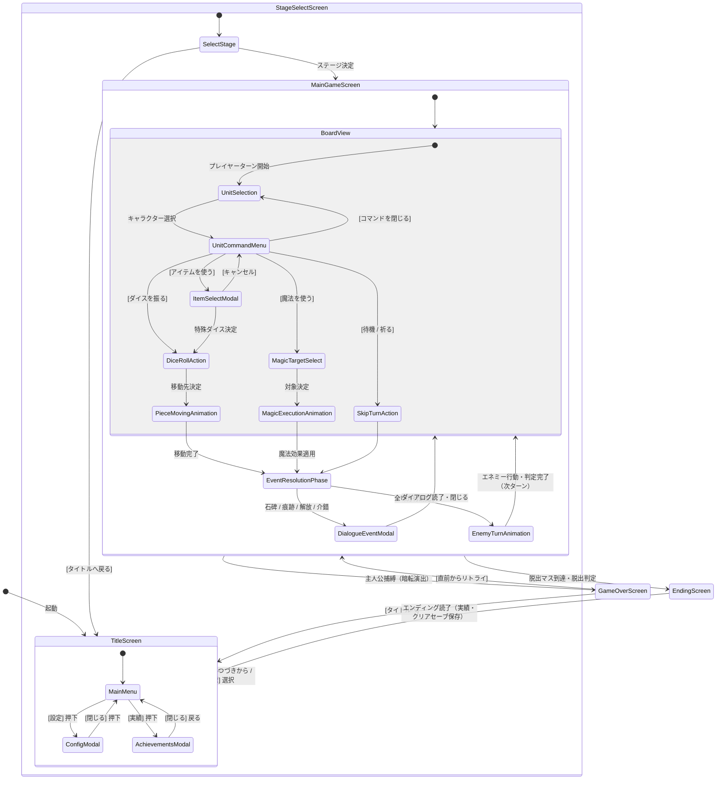

# 基本設計書：画面設計・UIレイアウトおよび画面遷移図

本書は、「すごろく×魔女の館脱出ゲーム」（Godot Engine 4 / PC向け）における画面構成、UIレイアウト、および画面遷移フローを定義した基本設計書である。実装後の**結合テスト仕様書（UI・画面遷移テスト）**へそのまま転用できる構成で記述する。

---

## 1. 画面遷移全体図



---

## 2. 画面一覧・詳細仕様

### (1) タイトル画面 (`TitleScreen`)
- **画面構成：**
  - **背景：** 霧に煙る洋館のシルエット、不穏なアンビエント音
  - **タイトルロゴ：** 『魔女の館と双六の生贄』（仮）
  - **メニューボタン一覧：**
    1. `はじめから`（新規ゲーム開始 → Stage 1 OPへ）
    2. `つづきから`（最新オートセーブまたは任意セーブから再開）
    3. `ステージ再探索`（クリア済みステージを選択して消費アイテムを保持したまま探索へ）
    4. `実績確認`（獲得した実績一覧モーダルを開く）
    5. `コンフィグ`（設定モーダルを開く）
    6. `ゲーム終了`（ウィンドウを閉じる）

---

### (2) メインゲーム盤面画面 (`MainGameScreen`)

解像度：1920x1080（ベース） / 16:9比率

```
+-------------------------------------------------------------------------------+
| [フロア情報: Stage 2 - 1F キッチン]  [ターン数: 05]   [ポーズ/メニュー]       |
+-------------------------------------------------------------+-----------------+
|                                                             | 【操作ユニット】|
|                                                             |  主人公 (探索者)|
|                                                             |  HP: 健全       |
|                                                             | ----------------|
|                                                             | 【コマンド】    |
|                     [盤面ボード表示エリア]                  |  [1. ダイス]    |
|                      (2D トップダウン表示)                  |  [2. アイテム]  |
|                                                             |  [3. 魔法]      |
|           ・マス（通常/宝箱/石碑/痕跡/介錯/階段など）       |  [4. 待機/祈る] |
|           ・キャラクターコマ（主人公・少女・魔女）          |  [5. 閉じる]    |
|                                                             | ----------------|
|                                                             | 【同行少女】    |
|                                                             |  炎の少女       |
|                                                             |  状態: 同行中   |
+-------------------------------------------------------------+-----------------+
| 【ログ / メッセージウィンドウ】                                               |
| 「炎の少女のターン：炎の魔法を行使した！ 魔女を撃破！」                       |
+-------------------------------------------------------------------------------+
```

#### ① ボード表示エリア（メインビュー）
- 有向グラフで接続されたマス（ノード）と経路（エッジ）を2Dタイルマップで描画。
- カメラは現在操作中のキャラクターを中心にある程度追従（ドラッグまたは右クリックで自由パン可能）。
- 各マスの種別アイコン（宝箱アイコン、石碑アイコン、怪しい魔術痕跡、かまど等の介錯オブジェクト）を明示。
- コマの演出：Godotノード（Tween / AnimationPlayer）による放物線ジャンプ移動。

#### ② コマンドパネル（右サイドバー）
- 現在アクティブな味方ユニットのステータスと共通コマンドを表示。
- ボタン一覧：
  - `ダイスを振る`：ダイスロールUIがポップアップし、1〜6を抽選。
  - `アイテムを使う`：所持アイテム（特殊ダイス）一覧ポップアップを表示。
  - `魔法を使う`：魔法行使モードへ移行。射程・対象選択マスがハイライト表示される。
  - `待機 / 祈る`：そのユニットの行動をパスする。
  - `コマンドを閉じる`：パネルを最小化し、盤面全体の確認を優先する（盤面クリック等で再表示）。

#### ③ ダイアログ・イベントモーダル (`DialogueEventModal`)
- 石碑の調査、魔術の痕跡発見、解放イベント、介錯イベント時に中央へオーバーレイ表示。
- ADV風の枠、テキスト送り（キー入力で即時全表示・ページ送り）、顔アイコン／イベントイラストの表示。

#### ④ 捕縛・暗転演出 (`GameOverModal`)
- 魔女と主人公が同一マスになった瞬間に発動。
- 画面が完全暗転し、不穏な環境音・陶器破壊音・衣擦れのSEのみが再生される（ゴア描画は排除）。
- 暗転明けに「捕縛・死亡」リザルトダイアログを表示（`タイトルへ` / `この階層をやり直す`）。

---

### (3) ステージ再探索画面 (`StageSelectScreen`)
- クリア済みのステージ（Stage 1〜Stage 6）を一覧表示。
- 各ステージの「石碑既読状況」「魔術の痕跡回収状況」「宝箱回収率」を表示。
- 現在所持している消費アイテム（1〜6の賽など）を引き継いだ状態で、任意のステージを選択して出撃できる。

---

### (4) 実績・コンフィグモーダル (`AchievementsModal` / `ConfigModal`)
- **実績画面：**
  - 実績項目（3つのエンディング到達、各属性魔法の行使、全痕跡の回収、全ダイス使用など）の解除状態・獲得日時を表示。
- **コンフィグ画面：**
  - マスター音量、BGM音量、SE音量スライダー（0〜100%）。
  - テキスト送り速度（低速 / 標準 / 高速 / 瞬間表示）。
  - 画面モード（フルスクリーン / ウィンドウ表示）。

---

## 3. 結合テスト仕様への転用観点（画面遷移・UIテスト）

| テスト項目ID | テスト対象画面 | 操作・入力条件 | 期待されるUI挙動 |
| :--- | :--- | :--- | :--- |
| **IT-UI-001** | タイトル画面 | `はじめから` 押下 | プロローグイベント（暗転テキスト）を経てStage 1へ遷移すること |
| **IT-UI-002** | タイトル画面 | `コンフィグ` 押下 | コンフィグモーダルがオーバーレイ表示され、タイトル操作が無効化されること |
| **IT-UI-003** | タイトル画面 | `実績` 押下 | 実績モーダルが表示され、セーブデータの達成状況が正しく描画されること |
| **IT-UI-004** | メインゲーム盤面 | 味方ユニットクリック | 該当ユニットが選択状態となり、コマンドパネル（4選択肢＋閉じる）が表示されること |
| **IT-UI-005** | メインゲーム盤面 | `コマンドを閉じる` 押下 | コマンドパネルが非表示になり、盤面全体の視認が可能となること |
| **IT-UI-006** | メインゲーム盤面 | `ダイスを振る` 押下 | ダイス回転アニメーション後に出目が確定し、移動可能マスがハイライトされること |
| **IT-UI-007** | メインゲーム盤面 | `アイテムを使う` 押下 | 所持している特殊ダイス一覧が表示され、選択時にダイス目が固定されること |
| **IT-UI-008** | メインゲーム盤面 | `魔法を使う` 押下 | 魔法の有効射程内の対象マスがハイライトされ、クリックで発動できること |
| **IT-UI-009** | メインゲーム盤面 | 石碑/痕跡マス停止 | 自動的にイベントダイアログが表示され、テキスト送り完了まで次操作がロックされること |
| **IT-UI-010** | メインゲーム盤面 | 主人公が魔女と同マス | 画面が暗転し、捕縛SE再生後、ゲームオーバーダイアログが表示されること |
