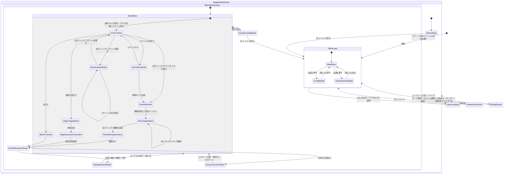

# 基本設計書：画面設計・UIレイアウトおよび画面遷移図

本書は、「すごろく×魔女の館脱出ゲーム」（Godot Engine 4 / PC向け）における画面構成、マウス主体のUI操作体系、および画面遷移フローを定義した基本設計書である。実装後の**結合テスト仕様書（UI・画面遷移テスト）**へそのまま転用できる構成で記述する。

---

## 1. 画面遷移全体図



---

## 2. 操作体系仕様（マウス完全対応・ワンハンド操作）

PCでのプレイ快適性と没入感を最大化するため、キーボードを使わず**マウス操作のみ**で直感的に完結するインターフェースを採用する。

| 操作フェーズ | マウス入力 | 挙動・機能 |
| :--- | :--- | :--- |
| **ターン開始時** | **左クリック** | マウスポインタ付近のコマンドメニューを選択（初期位置で「ダイスを振る」に合致）。 |
| | **右クリック** | コマンドメニューを非表示にし、「盤面確認モード」へ移行。 |
| **盤面確認モード** | **左ドラッグ** | 画面を掴んで自由にマップをスクロール（パン移動）。 |
| | **ホイール回転** | マップ全体のズームイン / ズームアウト（拡大・縮小）。 |
| | **右クリック** | マウスポインタ位置にコマンドメニューを再表示。 |
| **移動先選択時** | **右クリック** | 発光ハイライトされた移動可能マスをクリックして移動を決定・開始。 |
| | **左ドラッグ** | 移動先選択中であってもマップのスクロール・周囲確認が可能。 |
| **常時 / メニュー** | **コンフィグ呼出** | コマンドメニュー内の設定ボタン、または画面隅アイコンからConfigを開く（タイトル戻り可能）。 |

---

## 3. 画面一覧・詳細仕様

### (1) タイトル画面 (`TitleScreen`)
- **画面構成：**
  - **背景：** 霧に煙る洋館のシルエット、不穏なアンビエント音
  - **タイトルロゴ：** 『魔女の館と双六の生贄』（仮）
  - **メニューボタン一覧：**
    1. `はじめから`（新規ゲーム開始 → Stage 1 OPへ）
    2. `つづきから`（最新クリアセーブから再開：未クリア時は次ステージ直行、クリア済み時はステージ選択へ）
    3. `実績確認`（獲得した実績一覧モーダルを開く）
    4. `コンフィグ`（設定モーダルを開く）
    5. `ゲーム終了`（ウィンドウを閉じる）

---

### (2) メインゲーム盤面画面 (`MainGameScreen`)

解像度：1920x1080（ベース） / 16:9比率

```
+-------------------------------------------------------------------------------+
| [フロア情報: Stage 2 - 1F キッチン]  [ターン数: 05]              [コンフィグ] |
+-------------------------------------------------------------------------------+
|                                                                               |
|                             [2D グリッド盤面表示]                             |
|                                                                               |
|                   ・操作対象キャラが淡く発光（他キャラはディマー）            |
|                   ・マウス位置にコマンドポップアップ出現                      |
|                                                                               |
|                      +------------------------+                               |
|                      | 【コマンド】           |                               |
|                      |  [1. ダイスを振る] <-- |  (初期フォーカス)             |
|                      |  [2. アイテム]         |                               |
|                      |  [3. 魔法を使う]       |                               |
|                      |  [4. 祈る]             |                               |
|                      |  [右クリック: 閉じる]  |                               |
|                      +------------------------+                               |
|                                                                               |
|                   ・移動時は移動可能マスが淡く発光ハイライト                  |
|                   ・左ドラッグでマップスクロール、ホイールでズーム            |
|                                                                               |
+-------------------------------------------------------------------------------+
| 【ログ / メッセージウィンドウ】                                               |
| 「炎の少女のターン：炎の魔法を行使した！ 魔女を撃破！」                       |
+-------------------------------------------------------------------------------+
```

#### ① 操作演出・視覚フィードバック
- **アクティブキャラの発光：** プレイヤーターン開始時、現在操作中のキャラクターコマが淡い光（アウトライン/グロー）を放ち、未操作の味方やエネミーはやや暗く減光（ディマー）されてフォーカスを明示。
- **移動マスのハイライト：** ダイス出目決定後、到達可能な候補マスが淡く発光し、プレイヤーの直感的なルート選択を支援。
- **ドット絵演出：** コマはGodotのTweenによる放物線ジャンプでマス間を移動。

#### ② ダイアログ・イベントモーダル (`DialogueEventModal`)
- 石碑の調査、魔術の痕跡発見、解放イベント、介錯イベント時に中央へオーバーレイ表示。
- ADV風の枠、テキスト送り（クリックで即時全表示・ページ送り）、顔アイコン／イベントイラストの表示。

#### ③ 捕縛・暗転演出 (`GameOverModal`)
- 魔女と主人公が同一マスになった瞬間に発動。
- 画面が完全暗転し、不穏な環境音・陶器破壊音・衣擦れのSEのみが再生される（ゴア描画は排除）。
- 暗転明けに「捕縛・死亡」リザルトダイアログを表示（`タイトルへ` / `この階層をやり直す`）。

---

### (3) ステージ選択画面 (`StageSelectScreen`)（クリア済み周回・再探索）
- **解放条件：** 一度いずれかのエンディングに到達したクリアセーブデータのみ遷移可能。
- **画面仕様：**
  - 解放済みのステージ（Stage 1〜Stage 6）を一覧表示。
  - **探索のミステリー性を保持するため、石碑既読率・痕跡回収率・宝箱回収率はあえて非表示**とする。
  - **宝箱のリスポーン：** ステージに入るたびに宝箱マスは復活し、何度でも開けて賽アイテムを補充・回収できる。
  - 所持している消費アイテム（1〜6の賽など）を保持したまま、目的のステージを選択して出撃する。

---

### (4) コンフィグモーダル (`ConfigModal`)
- ゲーム中（盤面）およびタイトル画面の双方から呼び出し可能。
- **設定項目：**
  - マスター音量、BGM音量、SE音量スライダー（0〜100%）。
  - テキスト送り速度（低速 / 標準 / 高速 / 瞬間表示）。
  - 画面モード（フルスクリーン / ウィンドウ表示）。
  - `タイトルへ戻る`（ゲーム中モーダルのみ表示。セーブはステージクリア時のみのため、確認ダイアログを挟む）。

---

## 4. 結合テスト仕様への転用観点（画面遷移・UIテスト）

| テスト項目ID | テスト対象画面 | 操作・入力条件 | 期待されるUI挙動 |
| :--- | :--- | :--- | :--- |
| **IT-UI-001** | タイトル画面 | `はじめから` 押下 | プロローグイベント（暗転テキスト）を経てStage 1へ遷移すること |
| **IT-UI-002** | タイトル画面 | `つづきから` 押下（未クリア時） | ステージ選択を挟まず、直前のクリア後次ステージへ直接遷移すること |
| **IT-UI-003** | タイトル画面 | `つづきから` 押下（クリア済み時） | ステージ選択画面（再探索）へ遷移すること |
| **IT-UI-004** | メインゲーム盤面 | ターン開始 | 操作キャラが発光し、マウス位置にコマンドメニューが出現すること |
| **IT-UI-005** | メインゲーム盤面 | コマンド表示中に右クリック | コマンドメニューが非表示になり、盤面確認モードへ移行すること |
| **IT-UI-006** | 盤面確認モード | 左ボタンドラッグ / ホイール | マップが滑らかにスクロールし、ホイールで拡大縮小できること |
| **IT-UI-007** | 盤面確認モード | 右クリック | マウスポインタ位置にコマンドメニューが再表示されること |
| **IT-UI-008** | メインゲーム盤面 | ダイス出目決定後 | 移動可能マスが発光ハイライトされ、右クリックで移動先決定できること |
| **IT-UI-009** | メインゲーム盤面 | コンフィグからタイトル戻る | 確認ダイアログを経てタイトル画面へ正しく遷移すること |
| **IT-UI-010** | メインゲーム盤面 | 主人公が魔女と同マス（未潜行） | 画面が完全暗転し、捕縛SE再生後、ゲームオーバーダイアログが表示されること |
| **IT-UI-011** | ステージ選択画面 | ステージ再突入 | 所持消費アイテムが維持され、宝箱マスが未開封状態で配置されること |
