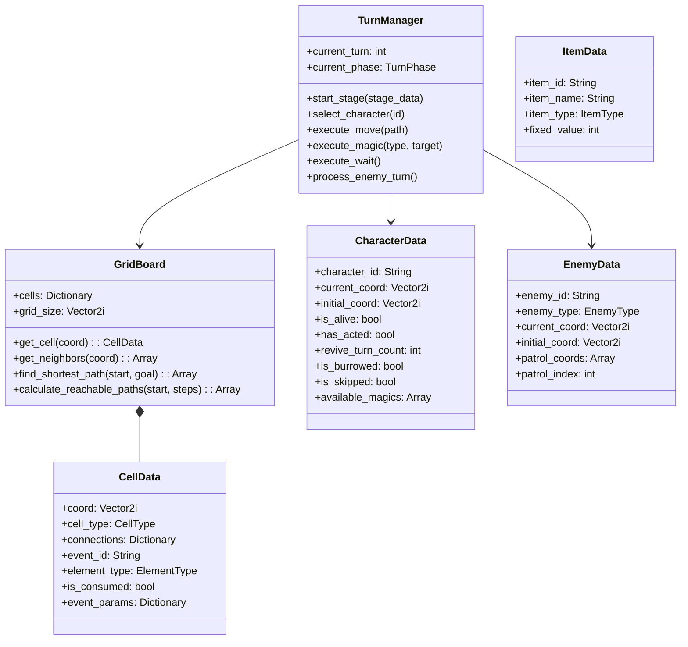

# 詳細設計書：クラス設計およびデータ構造詳細設計書

本書は、「すごろく×魔女の館脱出ゲーム」におけるGodot Engine 4 (GDScript) によるオブジェクト指向設計、クラス・ノード階層、データモデル、メンバ変数、メソッドシグネチャ、およびシグナル定義を記述した詳細設計書である。本設計は**単体テストコード（GUT）に1対1で対応**する粒度で策定されている。

---

## 1. システム全体クラスアーキテクチャ

本システムは、責務の分離と単体テスト容易性（ヘッドレス実行可能）を最大化するため、**純粋ロジック層（`RefCounted` / `Resource`）**と**表示・演出層（`Node2D` / `Control`）**を明確に分離するMVP（Model-View-Presenter）ライクな構成を採用する。



---

## 2. 定数および列挙型定義 (`Enums.gd`)

各システムで共通利用される列挙型はグローバルまたは定数スクリプト（`Enums.gd`）で定義する。

```gdscript
class_name Enums

## マス種別
enum CellType {
    NORMAL,            ## 通常マス（効果なし）
    EXIT,              ## 出口・階段マス（フロア遷移または脱出）
    EVENT,             ## イベントマス（宝箱、石碑、儀式、介錯など）
    ADDITIONAL_MOVE,   ## 追加移動マス（指定歩数さらに進む）
    RETURN_TO_START,   ## 振り出しマス（初期配置へ戻る）
    SKIP_TURN,         ## 1回休みマス（次ターン行動不能）
    ROLL_AGAIN,        ## もう一度マス（即座に再ダイス）
    WATER_TRAP         ## 水魔術トラップ（進入即ターン終了、突破に丸1ターン）
}

## 魔法属性種別
enum ElementType {
    NONE,
    FIRE,              ## 炎（2マス以内の通常魔女撃破）
    WATER,             ## 水（永続トラップ生成）
    WIND,              ## 風（直線上の対象を最遠部へ吹っ飛ばす）
    EARTH              ## 土（地中潜行でやり過ごす／魔女1ターン休み）
}

## 魔女行動タイプ
enum EnemyType {
    TRACKING,          ## ダイス追跡型（最短距離の味方を追跡）
    PATROL,            ## 周回巡回型（固定経路を往復）
    SENSOR             ## トラップ感知型（直線視界内で突進）
}

## ターン進行フェーズ
enum TurnPhase {
    STAGE_INIT,        ## ステージ初期化
    PLAYER_UNIT_SELECT,## プレイヤー：行動ユニット選択待ち
    PLAYER_ACTION_SELECT, ## プレイヤー：コマンド選択待ち（ダイス/アイテム/魔法/待機）
    PLAYER_MOVING,     ## プレイヤー：移動アニメーション＆1歩判定中
    ENEMY_THINKING,    ## エネミー：ターゲット選定・移動計画中
    ENEMY_MOVING,      ## エネミー：移動アニメーション＆1歩判定中
    TURN_END,          ## ターン終了処理（カウンタ更新・復活判定）
    GAME_OVER,         ## ゲームオーバー（主人公死亡）
    STAGE_CLEAR        ## ステージクリア
}

## アイテム種別
enum ItemType {
    FIXED_DICE,        ## 1〜6の固定ダイス
    CHOICE_DICE,       ## 意志の賽（1〜6から任意選択）
    DOUBLE_DICE,       ## 双子の賽（2個振って合算）
    KEY_ITEM           ## 正門の鍵、儀式の楔などの重要品
}
```

---

## 3. データモデルクラス詳細仕様

### 3.1 `CellData` (マスデータ)
純粋なデータオブジェクト（`RefCounted` を継承）。

```gdscript
class_name CellData
extends RefCounted

var coord: Vector2i = Vector2i.ZERO
var cell_id: int = 0
var cell_type: Enums.CellType = Enums.CellType.NORMAL
var connections: Dictionary = {
    Vector2i.UP: false,
    Vector2i.DOWN: false,
    Vector2i.LEFT: false,
    Vector2i.RIGHT: false
}
var event_id: String = ""
var element_type: Enums.ElementType = Enums.ElementType.NONE
var is_consumed: bool = false
var event_params: Dictionary = {}

func _init(p_coord: Vector2i = Vector2i.ZERO, p_type: Enums.CellType = Enums.CellType.NORMAL) -> void:
    coord = p_coord
    cell_type = p_type

## 辞書からのシリアライズ/デシリアライズ
func to_dict() -> Dictionary:
    return {
        "coord": [coord.x, coord.y],
        "cell_id": cell_id,
        "cell_type": cell_type,
        "connections": {
            "up": connections.get(Vector2i.UP, false),
            "down": connections.get(Vector2i.DOWN, false),
            "left": connections.get(Vector2i.LEFT, false),
            "right": connections.get(Vector2i.RIGHT, false),
        },
        "event_id": event_id,
        "element_type": element_type,
        "is_consumed": is_consumed,
        "event_params": event_params
    }

static func from_dict(data: Dictionary) -> CellData:
    var c = CellData.new(Vector2i(data["coord"][0], data["coord"][1]), data["cell_type"])
    c.cell_id = data.get("cell_id", 0)
    var conn = data.get("connections", {})
    c.connections[Vector2i.UP] = conn.get("up", false)
    c.connections[Vector2i.DOWN] = conn.get("down", false)
    c.connections[Vector2i.LEFT] = conn.get("left", false)
    c.connections[Vector2i.RIGHT] = conn.get("right", false)
    c.event_id = data.get("event_id", "")
    c.element_type = data.get("element_type", Enums.ElementType.NONE)
    c.is_consumed = data.get("is_consumed", false)
    c.event_params = data.get("event_params", {})
    return c
```

---

### 3.2 `CharacterData` (味方ユニットデータ)

```gdscript
class_name CharacterData
extends RefCounted

var character_id: String = ""       ## "HERO", "GIRL_FIRE", etc.
var name: String = ""
var current_coord: Vector2i = Vector2i.ZERO
var initial_coord: Vector2i = Vector2i.ZERO
var is_alive: bool = true
var has_acted: bool = false
var revive_turn_count: int = 0      ## 魔女に殺された後の復活ターン（初期3）
var is_burrowed: bool = false       ## 土魔法の潜行状態
var is_skipped: bool = false        ## 1回休み状態
var available_magics: Array[Enums.ElementType] = []

func _init(p_id: String, p_name: String, p_init_coord: Vector2i) -> void:
    character_id = p_id
    name = p_name
    initial_coord = p_init_coord
    current_coord = p_init_coord
    is_alive = true
    has_acted = false
    revive_turn_count = 0
    is_burrowed = false
    is_skipped = false

func reset_turn_state() -> void:
    if is_skipped:
        is_skipped = false
        has_acted = true  ## 休みにより自動行動済み
    else:
        has_acted = false

func kill() -> void:
    is_alive = false
    is_burrowed = false
    revive_turn_count = 3

func tick_revive() -> bool:
    if not is_alive and revive_turn_count > 0:
        revive_turn_count -= 1
        if revive_turn_count <= 0:
            is_alive = true
            current_coord = initial_coord
            has_acted = false
            return true  ## 復活した
    return false
```

---

### 3.3 `EnemyData` (魔女エネミーデータ)

```gdscript
class_name EnemyData
extends RefCounted

var enemy_id: String = ""
var enemy_type: Enums.EnemyType = Enums.EnemyType.TRACKING
var current_coord: Vector2i = Vector2i.ZERO
var initial_coord: Vector2i = Vector2i.ZERO
var is_alive: bool = true
var revive_turn_count: int = 0      ## 炎魔法で撃破された後の復活カウンタ（2ターン）
var patrol_coords: Array[Vector2i] = []
var patrol_index: int = 0
var stun_turns: int = 0             ## 土魔法による行動不能ターン（1ターン）

func _init(p_id: String, p_type: Enums.EnemyType, p_coord: Vector2i) -> void:
    enemy_id = p_id
    enemy_type = p_type
    initial_coord = p_coord
    current_coord = p_coord
    is_alive = true
    revive_turn_count = 0
    stun_turns = 0

func defeat() -> void:
    is_alive = false
    revive_turn_count = 2

func tick_revive() -> bool:
    if not is_alive and revive_turn_count > 0:
        revive_turn_count -= 1
        if revive_turn_count <= 0:
            is_alive = true
            current_coord = initial_coord
            return true
    return false
```

---

### 3.4 `ItemData` (アイテムデータ)

```gdscript
class_name ItemData
extends RefCounted

var item_id: String = ""
var name: String = ""
var item_type: Enums.ItemType = Enums.ItemType.FIXED_DICE
var fixed_value: int = 1   ## 1〜6の固定ダイス用の値

func _init(p_id: String, p_name: String, p_type: Enums.ItemType, p_val: int = 1) -> void:
    item_id = p_id
    name = p_name
    item_type = p_type
    fixed_value = p_val
```

---

## 4. 盤面グラフ・経路ロジック (`GridBoard.gd`)

### 4.1 責務とメソッド仕様
`GridBoard` はマス情報の管理、隣接判定、幅優先探索（BFS）による最短経路計算、および**出目折り返し移動の到達可能判定**を提供する。

```gdscript
class_name GridBoard
extends RefCounted

var cells: Dictionary = {}  ## Vector2i -> CellData
var grid_size: Vector2i = Vector2i(10, 10)
var start_coord: Vector2i = Vector2i.ZERO
var exit_coord: Vector2i = Vector2i.ZERO

## セルの登録
func add_cell(cell: CellData) -> void:
    cells[cell.coord] = cell

func get_cell(coord: Vector2i) -> CellData:
    return cells.get(coord, null)

func has_cell(coord: Vector2i) -> bool:
    return cells.has(coord)

## 双方向の隣接接続を設定
func connect_cells(coord_a: Vector2i, coord_b: Vector2i) -> void:
    var diff = coord_b - coord_a
    if cells.has(coord_a) and cells.has(coord_b):
        cells[coord_a].connections[diff] = true
        cells[coord_b].connections[-diff] = true

## 隣接する通行可能な座標リストを取得
func get_accessible_neighbors(coord: Vector2i) -> Array[Vector2i]:
    var neighbors: Array[Vector2i] = []
    if not cells.has(coord):
        return neighbors
    var cell = cells[coord]
    for dir in cell.connections.keys():
        if cell.connections[dir]:
            var target_coord = coord + dir
            if cells.has(target_coord):
                neighbors.append(target_coord)
    return neighbors

## 最短経路探索（BFS）: startからgoalまでの座標配列を返す（start含む）
func find_shortest_path(start: Vector2i, goal: Vector2i) -> Array[Vector2i]:
    if start == goal:
        return [start]
    var queue: Array[Vector2i] = [start]
    var visited: Dictionary = {start: null}
    
    while queue.size() > 0:
        var current = queue.pop_front()
        if current == goal:
            break
        for n in get_accessible_neighbors(current):
            if not visited.has(n):
                visited[n] = current
                queue.append(n)
                
    if not visited.has(goal):
        return []  ## 到達不可
        
    var path: Array[Vector2i] = []
    var curr = goal
    while curr != null:
        path.push_front(curr)
        curr = visited[curr]
    return path

## 指定歩数（出目）で到達可能なマスの集合を計算（折り返し移動許可）
## 戻り値: Dictionary (Vector2i -> bool)
func get_reachable_cells_with_steps(start: Vector2i, steps: int) -> Dictionary:
    var current_states: Dictionary = {start: true}
    for s in range(steps):
        var next_states: Dictionary = {}
        for c in current_states.keys():
            for n in get_accessible_neighbors(c):
                next_states[n] = true
        current_states = next_states
    return current_states

## 指定された経路（座標配列）が出目と合致し、接続が有効か検証する
func validate_path(path: Array[Vector2i], expected_steps: int) -> bool:
    if path.size() != expected_steps + 1:
        return false
    for i in range(path.size() - 1):
        var c = path[i]
        var n = path[i + 1]
        var diff = n - c
        if not cells.has(c) or not cells[c].connections.get(diff, false):
            return false
    return true
```

---

## 5. ターン・ゲーム進行制御 (`TurnManager.gd`)

### 5.1 シグナル定義
ViewおよびUIへ状態変化を通知するためのシグナル：

```gdscript
signal turn_changed(turn_num: int, phase: Enums.TurnPhase)
signal unit_selected(character_id: String)
signal unit_step_moved(unit_id: String, from_coord: Vector2i, to_coord: Vector2i, remaining_steps: int)
signal unit_overlap_detected(character_id: String, enemy_id: String, is_hero: bool)
signal water_trap_triggered(unit_id: String, coord: Vector2i)
signal cell_event_triggered(cell_data: CellData)
signal enemy_target_changed(enemy_id: String, target_unit_id: String)
signal enemy_step_moved(enemy_id: String, from_coord: Vector2i, to_coord: Vector2i)
signal magic_executed(element: Enums.ElementType, user_id: String, target_coord: Vector2i)
signal stage_cleared(stage_id: String)
signal game_over_triggered(reason: String)
```

### 5.2 制御メソッド詳細シグネチャ

```gdscript
class_name TurnManager
extends RefCounted

var board: GridBoard
var characters: Dictionary = {}  ## id -> CharacterData
var enemies: Dictionary = {}     ## id -> EnemyData
var current_turn: int = 1
var current_phase: Enums.TurnPhase = Enums.TurnPhase.STAGE_INIT
var active_character_id: String = ""
var stage_id: String = ""

## ステージ初期化
func setup_stage(p_board: GridBoard, p_characters: Array[CharacterData], p_enemies: Array[EnemyData], p_stage_id: String) -> void

## プレイヤーターン開始
func start_player_turn() -> void

## 味方ユニット選択
func select_character(character_id: String) -> bool

## 1歩ずつの移動実行（経路配列 path を1マスずつ進めてリアルタイム判定）
func execute_character_move_step(path: Array[Vector2i], step_index: int) -> Dictionary
## 戻り値: {
##    "status": "CONTINUE" | "STOPPED" | "GAME_OVER" | "GIRL_DIED" | "WATER_TRAP",
##    "current_coord": Vector2i,
##    "remaining_steps": int
## }

## 停止マスイベント解決
func resolve_stop_cell(character_id: String, coord: Vector2i) -> void

## 魔法実行（移動と二者択一）
func execute_magic(character_id: String, element: Enums.ElementType, target_coord: Vector2i) -> bool

## 待機・祈る実行
func execute_wait(character_id: String) -> void

## 味方の行動完了判定
func check_and_advance_player_turn() -> void

## エネミーターン実行（全敵の思考と移動）
func process_enemy_turn() -> void

## ターン終了・復活カウント更新
func end_turn_and_advance() -> void
```

---

## 6. ステージデータおよびリポジトリ設計 (`StageData.gd` / `StageRepository.gd`)

各階層（フロア）のマップ構造、初期配置、同行少女、および階層間の遷移定義をデータドリブンに管理する。

### 6.1 `StageData` (`RefCounted`)
各ステージの静的定義データを保持するモデルクラス。

```gdscript
class_name StageData
extends RefCounted

var stage_id: String = ""              ## "STAGE_1", "STAGE_2", etc.
var stage_name: String = ""            ## "Stage 1: 2F 廊下・客室"
var floor_number: int = 1              ## 階層番号（1〜6）
var board: GridBoard = null            ## グリッド盤面モデル
var hero_coord: Vector2i = Vector2i(1, 3)
var enemies: Array[Dictionary] = []    ## [{id: String, type: Enums.EnemyType, coord: Vector2i}]
var companions: Array[Dictionary] = [] ## [{id: String, name: String, element: Enums.ElementType, coord: Vector2i}]
var next_stage_id: String = ""         ## 次階層ID（最終階層は ""）
var initial_camera_pos: Vector2 = Vector2(480, 200)
var initial_camera_zoom: Vector2 = Vector2(0.95, 0.95)
```

### 6.2 `StageRepository` (`RefCounted`)
全ステージ（Stage 1〜6）の仮定義データおよびデータ取得を提供するリポジトリクラス。

```gdscript
class_name StageRepository
extends RefCounted

## ステージ定義取得
static func get_stage(stage_id: String) -> StageData

## 最初のステージID取得
static func get_first_stage_id() -> String

## 全ステージID一覧
static func get_all_stage_ids() -> Array[String]
```

---

## 7. 単体テスト観点対応表 (Traceability)


| クラス名 | テスト対象機能 | テスト仕様書項目 |
| :--- | :--- | :--- |
| `GridBoard` | マス隣接接続、最短経路探索(BFS) | `UT-BOARD-01` |
| `GridBoard` | 折り返し移動可能マスの計算・妥当性検証 | `UT-BOARD-02` |
| `TurnManager` | 1歩ごとの接触判定（主人公未潜行→即死、潜行→やり過ごし） | `UT-STEP-01` |
| `TurnManager` | 1歩ごとの水トラップ侵入（即時停止・ターンエンド） | `UT-STEP-02` |
| `TurnManager` | 追跡型魔女のターゲット選定優先順位（最短、同距離優先度） | `UT-ENEMY-01` |
| `TurnManager` | 4属性魔法効果（炎撃破、水トラップ生成、風吹っ飛ばし、土潜行） | `UT-MAGIC-01` |
| `TurnManager` | 少女死亡後の3ターン復活処理、エネミー2ターン復活処理 | `UT-TURN-01` |
