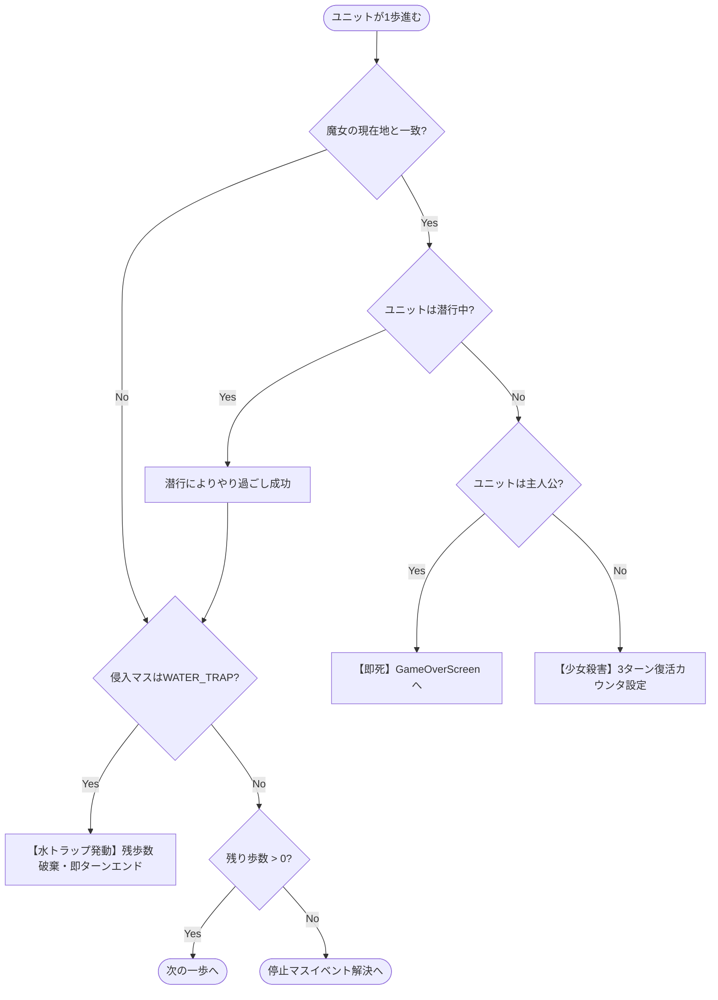

# 詳細設計書：ゲームロジックおよび状態遷移詳細設計書

本書は、「すごろく×魔女の館脱出ゲーム」におけるゲーム進行制御、リアルタイム1歩判定、エネミー思考AIアルゴリズム、魔法発動ロジック、およびマスイベント解決処理の具体的アルゴリズムを記述した詳細設計書である。本設計は**単体テストコード（UT）の実装ロジック**と完全一致する。

---

## 1. リアルタイム1歩移動と接触・トラップ判定アルゴリズム

### 1.1 アルゴリズム概要
味方ユニットまたは魔女が1歩移動するごとに、即座にマス上の重なり（接触）および地形トラップを評価する。ターン終了時の一括判定ではない。



### 1.2 実装ロジック詳細（擬似コード）

```gdscript
## ユニットが path の指定インデックスへ1歩進んだ際の判定処理
func step_unit(unit: CharacterData, to_coord: Vector2i, remaining_steps: int) -> Dictionary:
    unit.current_coord = to_coord
    
    # 1. エネミーとのリアルタイム接触判定
    for enemy in enemies.values():
        if enemy.is_alive and enemy.current_coord == to_coord:
            if unit.is_burrowed:
                # 潜行中：やり過ごし成功（ノーダメージ）
                emit_signal("burrow_pass_succeeded", unit.character_id, enemy.enemy_id)
            else:
                if unit.character_id == "HERO":
                    # 主人公捕縛：即時ゲームオーバー
                    current_phase = Enums.TurnPhase.GAME_OVER
                    emit_signal("game_over_triggered", "魔女に捕縛された")
                    return {"result": "GAME_OVER", "coord": to_coord}
                else:
                    # 少女捕縛：殺害演出、初期位置へ3ターン後復活
                    unit.kill()
                    emit_signal("unit_killed", unit.character_id)
                    return {"result": "GIRL_DIED", "coord": to_coord}

    # 2. 地形トラップ判定（水魔術トラップ）
    var cell = board.get_cell(to_coord)
    if cell and cell.cell_type == Enums.CellType.WATER_TRAP:
        # 残歩数をすべて破棄して即座にターン終了
        emit_signal("water_trap_triggered", unit.character_id, to_coord)
        return {"result": "WATER_TRAP_STOP", "coord": to_coord}

    # 3. 通常進行
    if remaining_steps > 0:
        return {"result": "CONTINUE", "coord": to_coord}
    else:
        return {"result": "ARRIVED", "coord": to_coord}
```

---

## 2. エネミー（魔女）AIアルゴリズム

エネミーターンにおける思考と移動は、以下の厳格なルールに基づいて決定論的（Deterministic）に処理される。

### 2.1 追跡ターゲット選定ルール (`select_tracking_target`)
追跡型（`TRACKING`）魔女は、以下の基準で追跡対象の味方ユニットを1名選定する：

1. **対象外除外：** 死亡中（`is_alive == false`）のユニットは除外。
2. **潜行状態の除外：** 地中潜行中（`is_burrowed == true`）のユニットは魔女から感知できないため除外。
3. **最短距離優先：** 未潜行の生存ユニットのうち、現在の魔女位置からの最短経路長（BFSステップ数）が最小のユニットを選択。
4. **同距離時のタイブレーク優先順位：**
   `主人公 (HERO) > 炎 (FIRE) > 風 (WIND) > 水 (WATER) > 土 (EARTH) > その他`
5. **全員潜行時（未潜行ユニットなし）：**
   ターゲットは `null` となり、魔女は自身の初期配置座標（`initial_coord`）へ向かって最短経路で移動する。

```gdscript
func select_witch_target(enemy: EnemyData) -> CharacterData:
    var candidates: Array[CharacterData] = []
    for c in characters.values():
        if c.is_alive and not c.is_burrowed:
            candidates.append(c)
            
    if candidates.is_empty():
        return null  ## 全員潜行中
        
    var best_target: CharacterData = null
    var min_dist: int = 999999
    
    # 優先順位マップ（小さいほど高優先）
    var priority_map = {
        "HERO": 0, "GIRL_FIRE": 1, "GIRL_WIND": 2, "GIRL_WATER": 3, "GIRL_EARTH": 4
    }
    
    for c in candidates:
        var path = board.find_shortest_path(enemy.current_coord, c.current_coord)
        var dist = path.size() - 1 if path.size() > 0 else 999999
        
        if dist < min_dist:
            min_dist = dist
            best_target = c
        elif dist == min_dist:
            var current_prio = priority_map.get(c.character_id, 99)
            var best_prio = priority_map.get(best_target.character_id, 99)
            if current_prio < best_prio:
                best_target = c
                
    return best_target
```

### 2.2 魔女の移動実行ロジック
- **追跡型 (`TRACKING`)：**
  - ダイス出目（1〜6）または固定歩数を取得。
  - 選定ターゲットへの最短経路を取得。全員潜行時は `initial_coord` への最短経路を取得。
  - 出目分だけ経路に沿って1歩ずつ進行し、各歩で生存味方との接触判定を実行。
  - 水魔術トラップに侵入した場合は即時停止し、移動を終了する。
- **周回型 (`PATROL`)：**
  - 定められた巡回座標リスト `patrol_coords` の次インデックスへ向かって最短移動。
  - 到達時にインデックスをインクリメント（終端で0へループ）。
- **感知型 (`SENSOR`)：**
  - 上下左右の4直線上を走査（壁マスで遮断されるまで）。
  - 未潜行の味方を発見した場合、即座にそのユニットの方向へ最大歩数突進する。

---

## 3. 4属性魔法効果詳細ロジック (`MagicSystem`)

味方ユニットは、自ターンにおいて「ダイス移動」を行うか「魔法使用」を行うかの**二者択一**となる。

| 魔法属性 | 行使者（初期） | 射程・対象 | 効果詳細ロジック | 単体テストID |
| :--- | :--- | :--- | :--- | :--- |
| **炎 (FIRE)** | 炎の少女 / 主人公(逆走時) | 自身から曼哈頓/BFS距離2マス以内の魔女1体 | ・魔女を撃破（`is_alive = false`）<br>・魔女は初期位置で2ターン後に復活<br>・自身の潜行解除 | `UT-MAGIC-01` |
| **水 (WATER)** | 水の少女 / 主人公(逆走時) | 自身から直線3マス以内の任意の1マス | ・指定マスを `WATER_TRAP` に変更<br>・永続地形となり、踏んだユニット（敵味方）は進入即停止<br>・自身の潜行解除 | `UT-MAGIC-02` |
| **風 (WIND)** | 風の少女 / 主人公(逆走時) | 自身の上下左右直線上にいる味方・敵・自身 | ・対象ユニットをその方向の突き当たり（壁の手前）のマスまで一瞬で吹き飛ばす<br>・吹き飛び途中のマス効果は発動しない<br>・停止マスイベントのみ発動 | `UT-MAGIC-03` |
| **土 (EARTH)** | 土の少女 / 主人公(逆走時) | 自身または味方1体 / または魔女1体 | ・味方に使用時：`is_burrowed = true`（潜行状態）。魔女の接触を無効化。<br>・「祈る/待機」選択で潜行継続。移動・魔法使用で解除。<br>・魔女に使用時：魔女を1ターンスタン（行動スキップ） | `UT-MAGIC-04` |

---

## 4. 停止マスイベント解決アルゴリズム (`resolve_stop_cell`)

残り歩数が0になりマスに停止した際に実行される判定フロー：

```gdscript
func resolve_stop_cell(character: CharacterData, cell: CellData) -> void:
    match cell.cell_type:
        Enums.CellType.EXIT:
            # 脱出または階段移動
            emit_signal("stage_cleared", stage_id)
            
        Enums.CellType.RETURN_TO_START:
            # 振り出し：初期配置マスへ強制帰還
            character.current_coord = character.initial_coord
            emit_signal("returned_to_start", character.character_id)
            
        Enums.CellType.ADDITIONAL_MOVE:
            # 追加移動：パラメータで指定された歩数（例: +2）の追加移動権を付与
            var extra_steps = cell.event_params.get("steps", 2)
            # 再び移動選択モードへ移行（連鎖判定あり）
            grant_additional_move(character, extra_steps)
            
        Enums.CellType.SKIP_TURN:
            # 1回休み：次ターンの行動を封じる
            character.is_skipped = true
            emit_signal("turn_skipped_applied", character.character_id)
            
        Enums.CellType.ROLL_AGAIN:
            # もう一度：即座にダイスを振り直して行動可能
            character.has_acted = false
            emit_signal("roll_again_granted", character.character_id)
            
        Enums.CellType.EVENT:
            # 宝箱、石碑、介錯などの個別イベント
            if not cell.is_consumed:
                process_event_cell(character, cell)
                
        Enums.CellType.NORMAL, Enums.CellType.WATER_TRAP:
            # 効果なし（水トラップは侵入時に処理済み）
            pass
```

---

## 5. 出目消費と折り返し移動経路計算アルゴリズム

### 5.1 プレイヤーの操作フロー
1. 出目 `N` が決定（通常ダイス 1〜6、またはアイテム固定賽）。
2. システムは `board.get_reachable_cells_with_steps(start_coord, N)` により到達可能マスをハイライト。
3. 最短経路であれば、プレイヤーが目的マスをマウスホバーするだけで点線矢印プレビュー表示。
4. **折り返し移動（行きつ戻りつ）を行う場合：**
   - プレイヤーは途中の「中継マス」をクリックして経路を固定し、残りの歩数を逆走指定可能。
5. 左クリックで移動確定、右クリックで選択解除。

```gdscript
## 出目 N を消費して折り返し移動可能な経路を生成・検証する
func validate_and_build_path(start: Vector2i, waypoints: Array[Vector2i], total_steps: int) -> Array[Vector2i]:
    var full_path: Array[Vector2i] = [start]
    var current = start
    
    for pt in waypoints:
        var sub_path = board.find_shortest_path(current, pt)
        if sub_path.is_empty():
            return []  ## 接続されていない
        # sub_path[0] は current と一致するためスライス
        for i in range(1, sub_path.size()):
            full_path.append(sub_path[i])
        current = pt
        
    if full_path.size() - 1 != total_steps:
        return []  ## 歩数が正確に出目と合致しない
        
    return full_path
```
